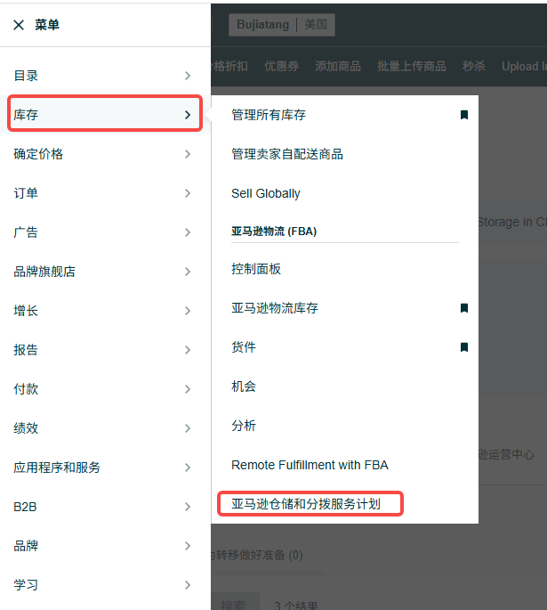
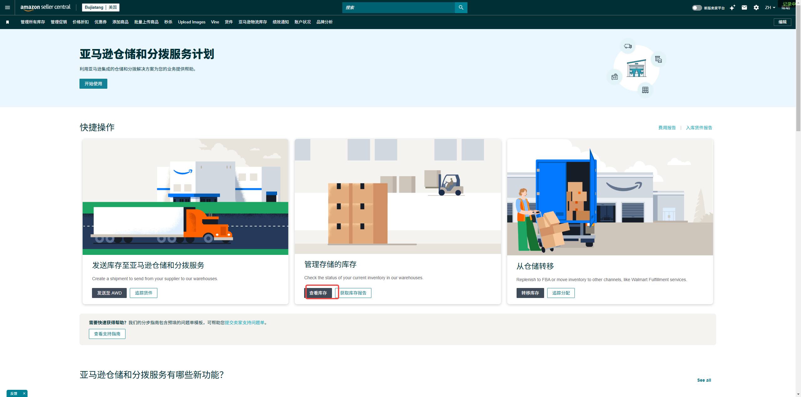
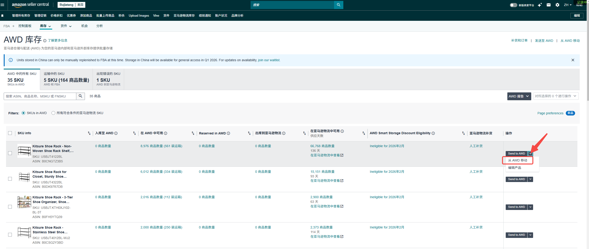

# 一、目的

AWD是亚马逊推出的仓储和分销服务，我司通过对接领星ERP体现单据流和数据流，但由于AWD功能的过渡问题，造成AWD补货功能目前是人为手动推动单据。故编写此操作指南说明。

# 二、AWD的介绍

AWD又称为亚马逊仓储和分拨服务，是一种低成本的批量仓储解决方案，适用于您分拨到亚马逊商城和其他分拨渠道的库存。此外，该计划还会为您在支持 Prime 的亚马逊运营中心的库存自动补货。常规上可以把它视作另一种亚马逊单独只做仓储服务的FBA前端仓库。

具体的AWD功能和后台操作可以见：

| 序号 | 内容（其他内容可以基于下述页面内容中相关文章延伸去看） |
|-|-|
| 1 | [亚马逊仓储和分拨服务](https://sellercentral.amazon.com/help/hub/reference/external/GF6ZC8VEBM7HCEGV?locale=zh-CN) |
| 2 | [亚马逊仓储和分拨服务库存](https://sellercentral.amazon.com/help/hub/reference/external/GQ95WW7597USRF5P?locale=zh-CN) |
| 3 | [从亚马逊仓储和分拨服务 (AWD) 向亚马逊物流配送网络补货](https://sellercentral.amazon.com/help/hub/reference/external/GKH7ASMAL93YECBF?locale=zh-CN) |
| 4 | [亚马逊仓储和分拨服务费用](https://sellercentral.amazon.com/help/hub/reference/external/GAYG62Q3MPE6STFS?locale=zh-CN) |
| 5 | [使用亚马逊仓储和分拨服务的多渠道分拨](https://sellercentral.amazon.com/help/hub/reference/external/GEPTXX9PMMXUKMK9?locale=zh-CN) |

# 三、AWD补货至FBA

1）亚马逊仓储和分拨服务（AWD）补货模式分为自动补货和手动补货两种模式。具体可参照上述内容3“[从亚马逊仓储和分拨服务 (AWD) 向亚马逊物流配送网络补货](https://sellercentral.amazon.com/help/hub/reference/external/GKH7ASMAL93YECBF?locale=zh-CN)”。

自动补货的优势在于如果得到的百分比等于或大于 70%，则该 ASIN 无需支付低库存水平费用和仓储利用率费用。

考虑到我们的MSKU分配和亚马逊补货算法的滞后，目前我们采取较多模式为手动补货。

2）菜单栏-库存-亚马逊仓储和分拨服务计划-查看库存-选择需要的MSKU/FNSKU-操作-从AWD移动-选择对应的数量补货即可。

