# **一、不可售库存的定义与分类**

不可售库存是指存放在亚马逊FBA仓库中，但因各种原因无法正常销售的商品。这些商品无法被买家购买，且需卖家主动处理（如清货、弃置或退回）。

# **二、不可售库存类型**

## 1、买家退货导致的不可售

a.商品状态问题：

已拆封、使用过、损坏、缺少配件。

退货时标签或包装损坏（如原厂包装被撕毁）。

b.退货原因：

买家主观原因（如“不想要了”但商品完好）。

商品实际存在问题（如功能故障、过期）。

## 2、 FBA仓库操作导致的不可售

a.亚马逊在入库、存储或配送过程中损坏商品（如挤压、淋湿）。

b.仓库丢失商品后找回，但状态已不可售。

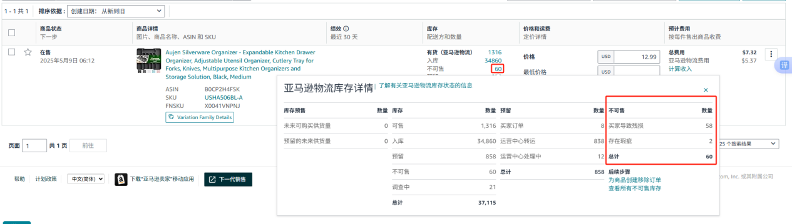

管理库存页面点击不可售数量，可查看具体不可售原因。

# **三、操作频率**

每月5日和20日，亚马逊会自动发起批量清货与退货，所以需在亚马逊生成订单前操作，也就是每月5日和20日之前，一个月操作两次。每次先在紫鸟后台操作清货，再去AK系统操作弃置。

# **四、清货（Liquidation）流程**

## 1、清货适用条件

商品无侵权、非危险品、非受限商品。

## 2、操作步骤

1）路径：卖家后台 > 库存 > 管理所有库存 > 移除不可售商品。

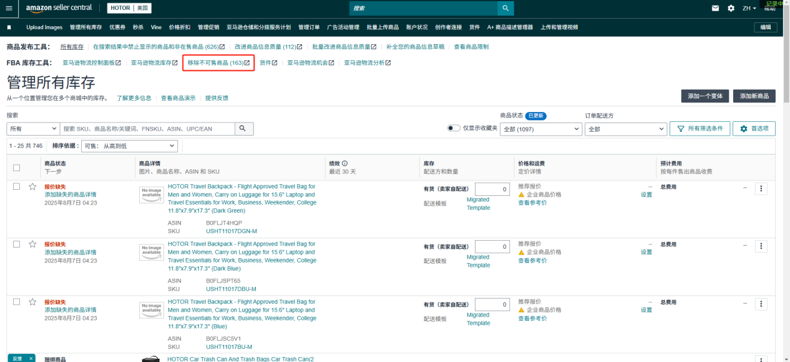

2）如果产品条数在一页内，点击选择全部，点击创建移除订单。

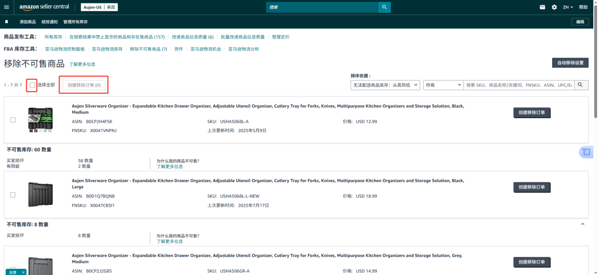

3）如果数量过多可滑到页面最下方选择显示50条，然后一页一页重复操作。选择显示100条可能因数量过多而报错。

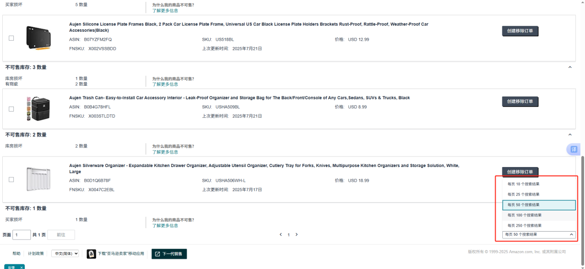

4）选择批量清货，在空白处填写数量，下方显示共几件就填几件。

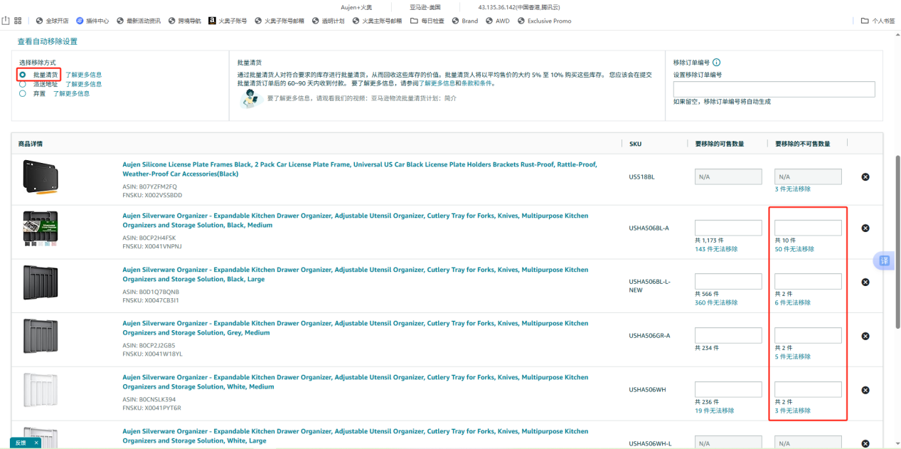

5）填写完成后点击最下方查看。

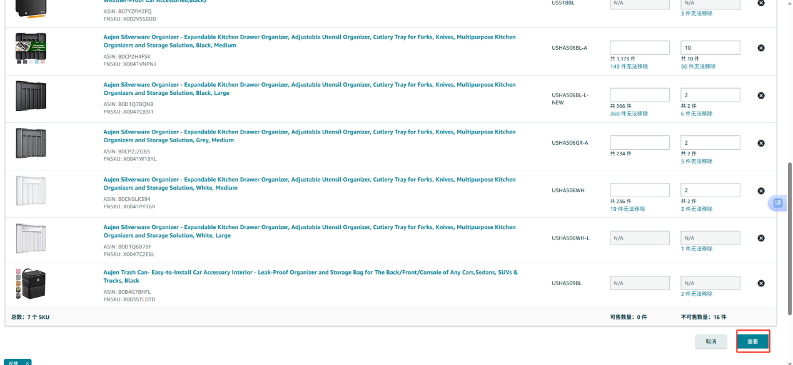

4）核对可售数量为0，移除方法为批量清货后点击确认。

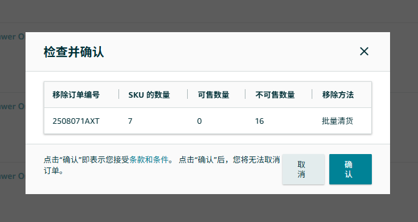

## 3、清货费用与规则

费用：售价的 5%-10%（按商品类别和状态浮动）。

限制：每个ASIN每月最多清货 500件。

# **五、弃置（Disposal）标准流程**

## 1、弃置适用场景

a.商品已损坏/过期/无任何销售价值。

b.清货不成功或成本高于弃置费用。

## 2、操作步骤

1）路径：AK系统 > 统计 > 移除订单。

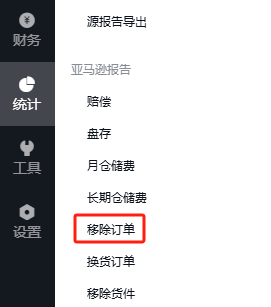

2）点击添加订单 。

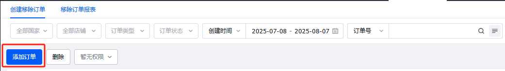

3）搜索店铺选择需操作的站点，移除类型选择销毁（Disposal），点击添加商品。

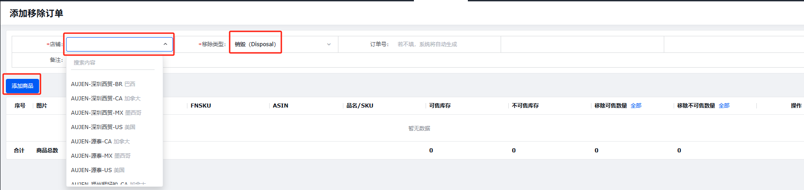

4）点击筛选，不可售库存填大于0后搜索。

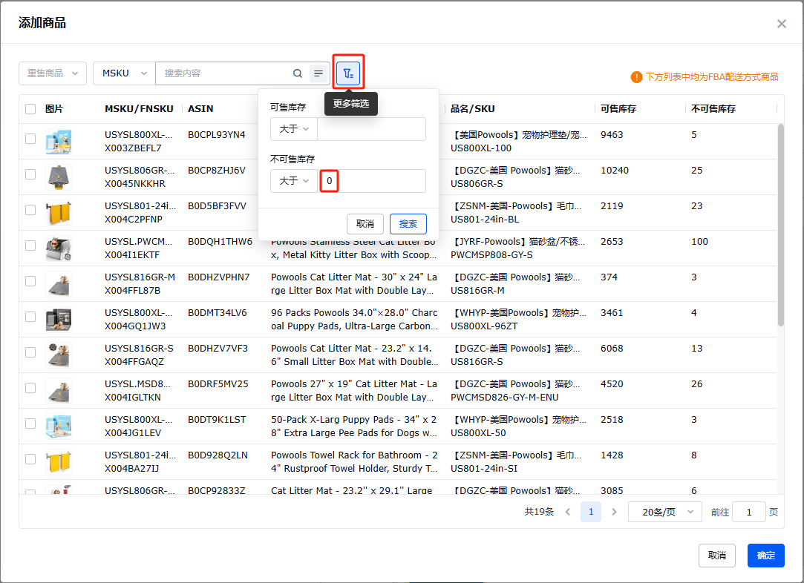

5）选择需要操作的商品后点击确定

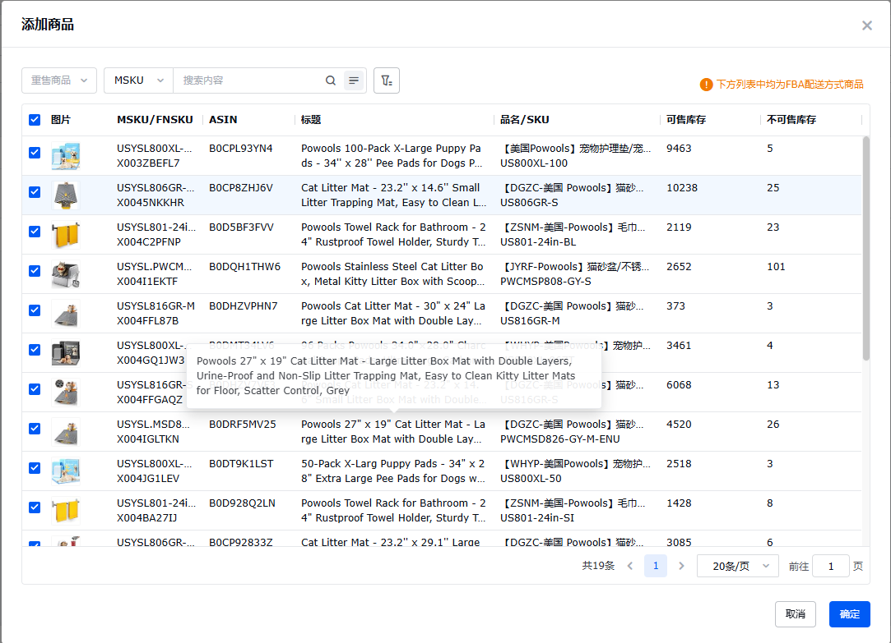

6）移除不可售数量处点击全部，然后点击保存就提交好了。这时订单状态显示待提交，之后需找对应的事业部经理，提醒AK提交订单，提交后状态则显示已提交。

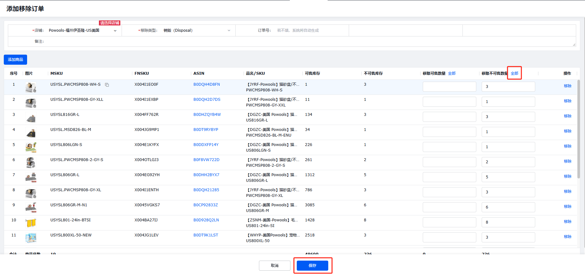

## 3、 弃置费用参考

商品尺寸费用（USD/件）

标准尺寸\$0.15-\$0.30

大件商品\$0.50-\$1.00

# 六、亚马逊后台相关政策内容

## 1、亚马逊物流弃置订单费用

[亚马逊物流弃置订单费用](https://sellercentral.amazon.com/help/hub/reference/external/G5FKTA8LXU4TZPD5?locale=zh-CN)

## 2、亚马逊物流移除订单费用

[亚马逊物流移除订单费用](https://sellercentral.amazon.com/help/hub/reference/external/G9W7FVTLY343ZBKN?locale=zh-CN)

## 3、亚马逊物流批量清货计划

[亚马逊物流批量清货计划](https://sellercentral.amazon.com/help/hub/reference/external/GDGTCW9RUAJ3S9KD?locale=zh-CN)