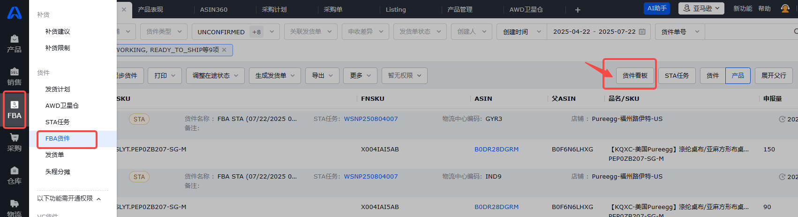
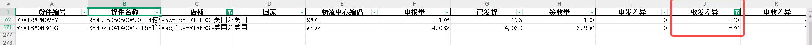
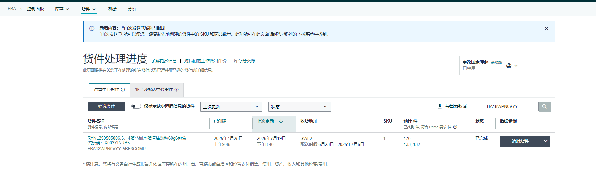
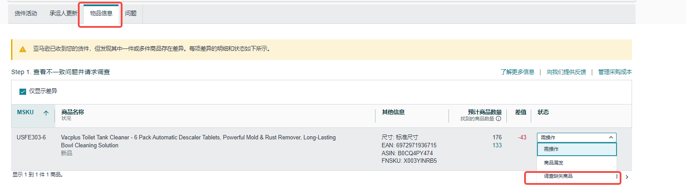
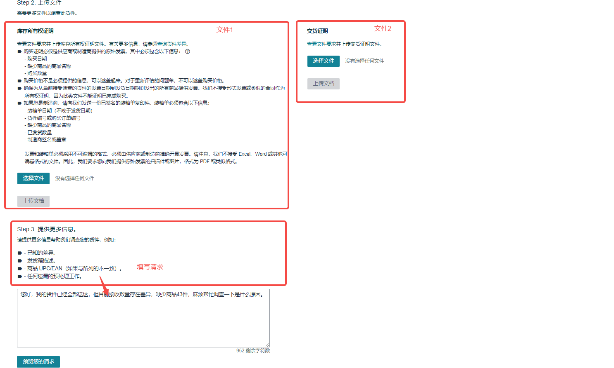

# FBA货件差异索赔操作流程
**关键内容：货件差异索赔**

**内容：店铺近三个月货件发收差异索赔-操作流程**

# **1、筛选存在接收差异的货件**

①AK →FBA →FBA货件 →点击货件看板

②货件看板筛选 →店铺：需要检查的店铺、状态：CLOSED、收发差异：签收量<发货量、创建时间：近三个月；

下载文件，筛选收发差异≥30的货件，使用货件编号到店铺后台提交差异调差。

# **2、后台提交差异调查**

①使用货件编号进行货件搜索 →点击追踪货件 →查看物品信息 →选择状态：调查缺失商品

②提交调查文件：

文件1、装箱单：编辑装箱单(PACKING LIST)模板**PACKING LIST 模板**（原件未收录，见飞书），填写货件对应信息提交。填写完后需要打印出来签字，转成PDF上传；

文件2、交货证明：可以问建单的物流同事要一下交货证明文件；

Step3备注诉求，点击预览请求，发起调查后会生成CASE id，需关注亚马逊调查进度。

=