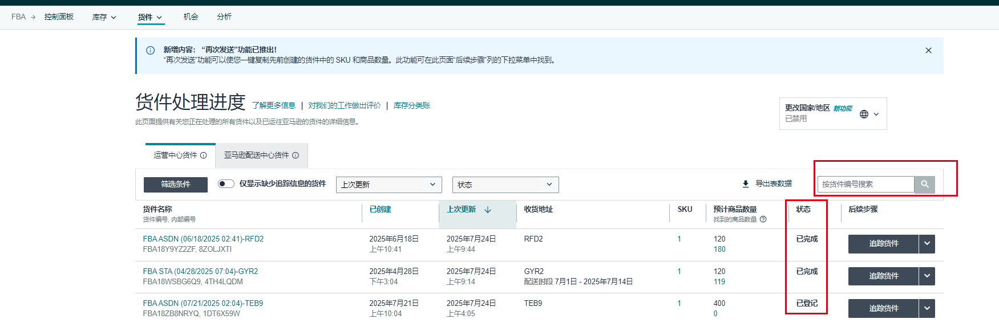

# FBA货件状态查询操作流程
**关键内容：货件状态查询**

**内容：货件状态查询－操作流程**

# **1、查询货件编号（FBA编号）**

- **路径**：供应链计划表－物流发货货件表 > 输入采购单号（PO单号）查询

![图片展示的是供应链计划表中物流发货货件表界面。表格中包含货件编号、采购单号、产品名称、产品SKU、产品数量、预计到港时间、实际到港时间、实际开船时间、实际入仓时间、物流备注等信息。其中，部分货件编号被红色框线突出显示，如FBA00000000000000000000000000000000000000000000000000000000000000000000000000000000000000000000000000000000000000000000000000000000000000000000000000000000000000000000000000000000000000000000000000000000000000000000000000000000000000000000000000000000000000000000000000000000000000000000000000000000000000000000000000000000000000000000000000000000000000000000000000000000000000000000000000000000000000000000000000000000000000000000000000000](../../../attachments/亚马逊运营/计划运营SOP课程存档/imgs/K9Ymbbg3WodDjKxMp8lcDGpbn6e.png)

- 注：表格中也可查看更新的货件状态（实际开船时间/实际到港时间/实际入仓时间/物流备注）；
- 货件到港后，需要尽快入库的产品，可联系对应物流同事让货代尽快派送。

# **2、使用货件编号，进入店铺后台查看状态：**

## **1）路径**

库存 > 亚马逊物流货件（FBA shipments）> 输入货件编号查看货件状态

## **2）货件状态定义**

**【1】处理中（Working）**

- 含义：正在创建或编辑货件，还没提交确认。
- 可操作：可以添加商品、修改数量、选择配送方式。
- 注意：还没进入发货流程。

**【2】准备发货（Ready to Ship）**

- 含义：已经完成货件创建、确认内容，正在准备打包、贴标签、预约取件。
- 可操作：打印箱唛、填写物流信息。

**【3】已发货（Shipped）**

- 含义：在后台点击了“标记为已发货”，但亚马逊还没收到货物。
- 注意：这个状态靠卖家手动确认，并不表示亚马逊真的收到了货。

**【4】运输中（In Transit）**

- 含义：货件正在运输途中，已被物流公司接收。
- 通常为承运人上传的轨迹自动更新此状态。

**【5】已送达（Delivered）**

- 含义：货件已送到亚马逊仓库门口。但货物还没被亚马逊扫描/登记入库。
- 属于“到仓但未处理”。

**【6】已登记（Checked-In）**

- 含义：亚马逊系统已扫描到货件条码或入库预约信息，登记了货件到达。
- 说明：已开始入仓流程，但尚未扫描每件商品。
- 注意：可能会在这个状态停留数小时到几天，具体取决于仓库拥堵情况。旺季可能更久。

**【7】正在接收（Receiving）**

- 含义：亚马逊正在检查、开箱、扫描、入库你的商品。
- 入库速度视旺季/淡季而定，可能数小时到数天。

**【8】已完成（Closed）**

- 含义：货件流程已全部结束。
- 亚马逊已接收完所有商品；或处理了所有异常（如缺失/多发）；或当货件自货件创建之日起已处于开放状态超过 45 天（国内货件）或 75 天（国际货件）（以时间较早者为准），系统自动关闭该货件。

**【9】已取消（Cancelled）**

- 含义：主动取消了还未发出的货件，或系统超期未处理自动取消。
- 注意：无法再恢复，只能新建一个货件。

**【10】已删除（Deleted）**

- 含义：货件计划被删除。
- 通常是误建、测试或作废货件。与“已取消”类似，但是人为操作删除。