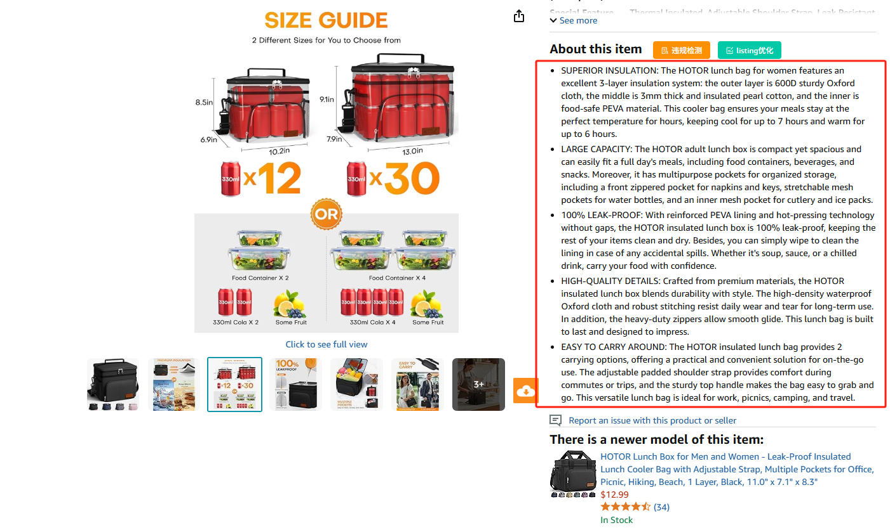
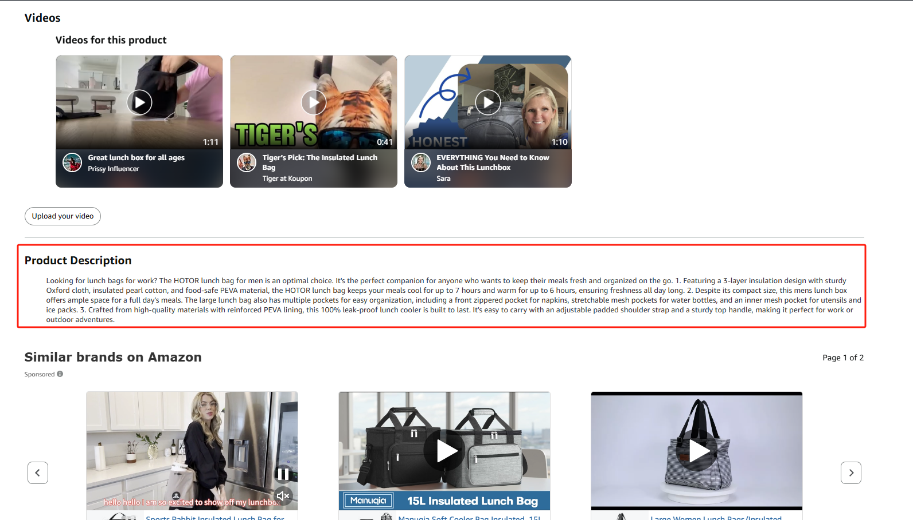
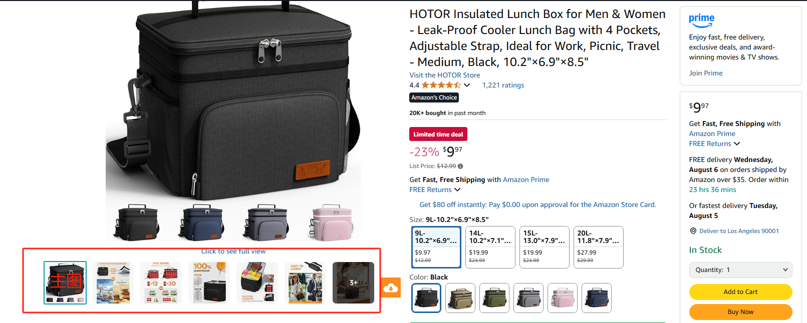
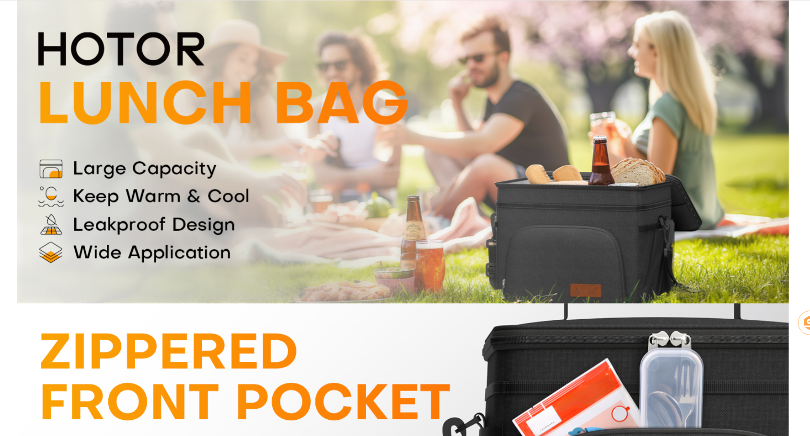
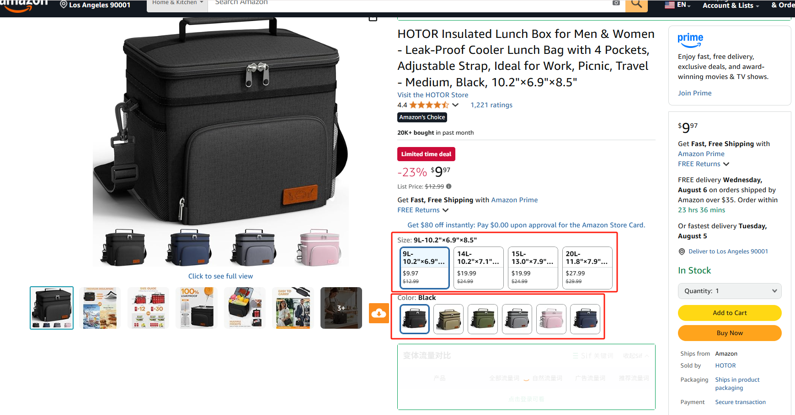

# 一、listing是什么

Listing即商品详情页，它是由7个要素组成的。

## 1、标题(Title)

即商品名称，通过品牌名+产品名+产品特征/型号等的格式对商品本身进行描述且便于消费者理解商品，标题是亚马逊站内外最重要的搜索项目。

## 2、商品要点（Bullet Point)

突出有关商品的重要信息或特殊信息，买家依靠商品要点来了解商品。最多可以填写5条商品要点，常称为五点描述。

## 3、商品描述（Product Description）

商品描述是对商品的文本说明，提供更详细的商品信息和详情。

## 4、商品图片（Product Image）

产品图片可以上传一张或多张。商品的主要图片被称作“主图-Main lmage”。商品的主图显示在搜索结果和浏览页中，也是买家在商品详情页面上看到的第一张图片。附加图片被称作“辅图-Other lmage/Sub Image”。商品的主要图片应配有一些附加的图片，以从不同的角度来展示商品、展示使用中的商品和在“主图”中没有显示的细节。

## 5、搜索关键词(Search Term)

代表商品的词组和短语；用于将卖家的商品与买家查找商品时输入的搜索词匹配。买家通过输入关键词进行搜索，而关键词将与卖家为商品提供的信息（商品名称、描述等）匹配。文本匹配度、商品价格、供货情况、选择和销售历史记录等因素共同决定了商品在买家搜索结果中的排名。通过为商品提供具有相关性且完整的信息，可以提高商品的曝光度和销量。

## 6、A+页面

通过图片和文字组合提高商品宣传效果的商品描述。通过组合图片与商品说明，更好地体现商品特征、差异点、商品魅力等具体的诉求点，从而起到促进消费者购买决定的效果。

## 7、分类节点（Browse Node）

分类节点是对产品进行分类的终端节点，用于添加新商品的场合；亚马逊买家可通过搜索和浏览功能来查找商品。买家在浏览时可以通过选择特定的商品分类和子分类来进—步缩小搜索范围。

# 二、变体（Variation）

根据亚马逊定义，产品变体（也称为父体子体关系）是相互关联的产品集。良好的变体listing允许购买者在单个产品详情页面上，根据产品的不同属性比较和选择产品。常见的变体有颜色、尺寸、数量。