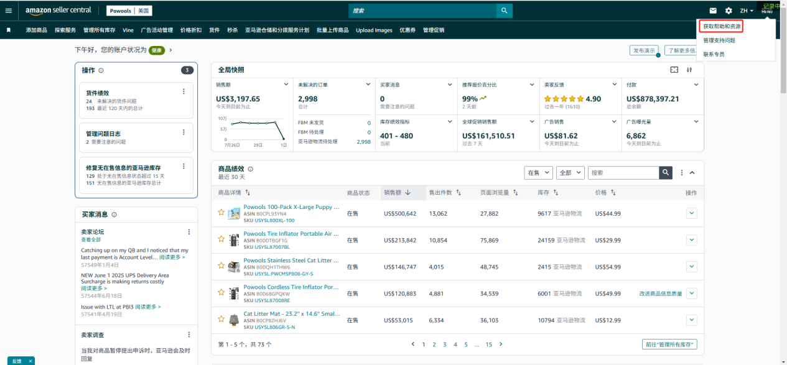
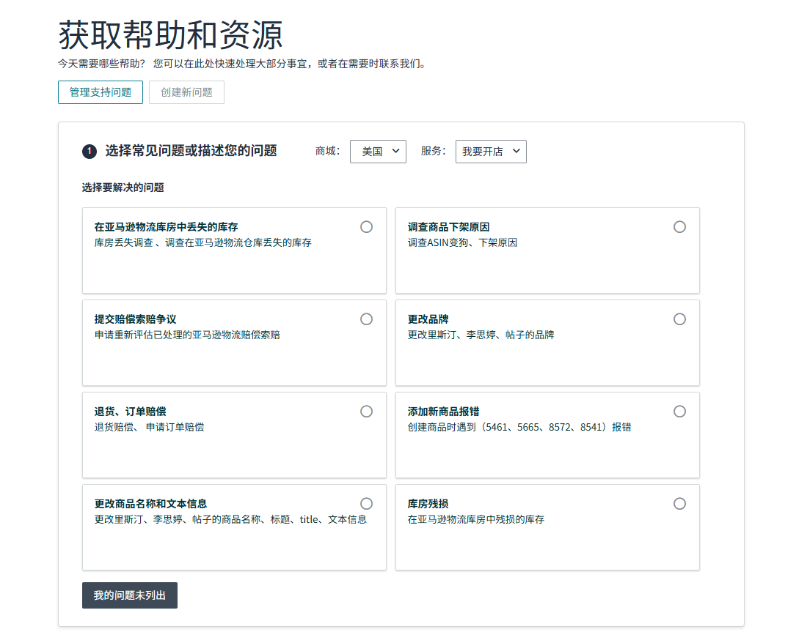
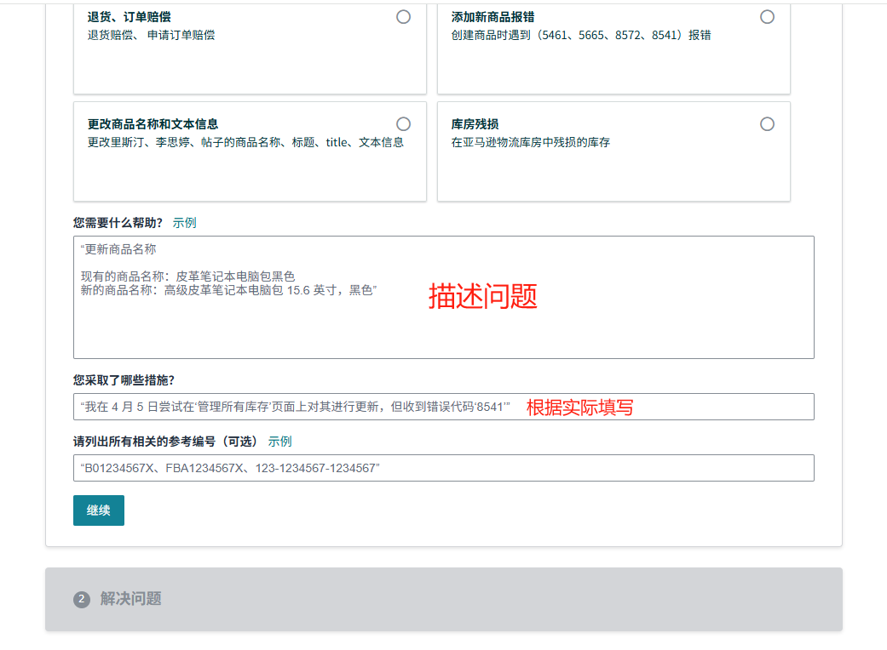
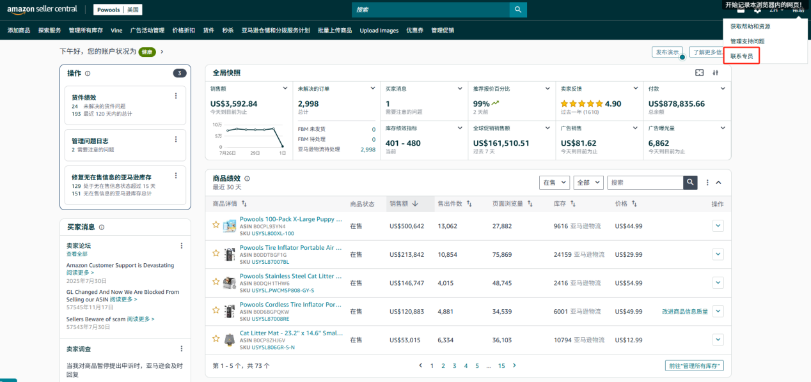
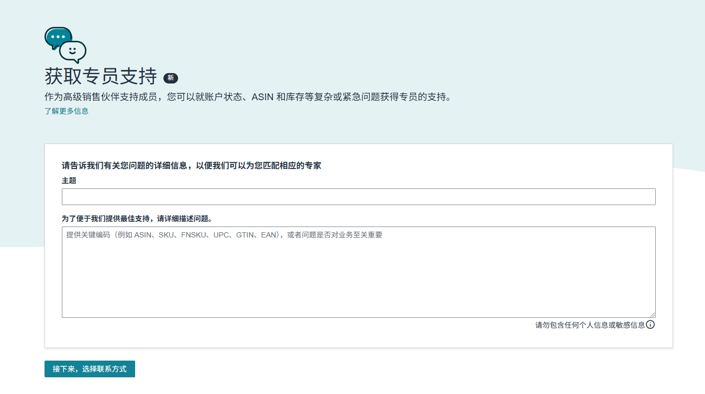
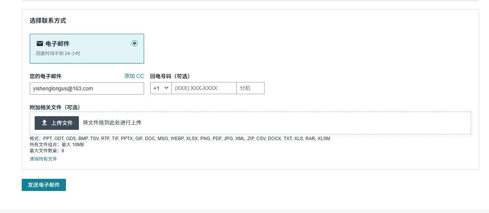
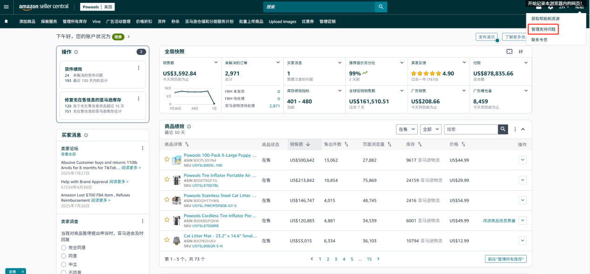

# 一、CASE（亚马逊帮助和支持）类型

1、普通Case；

2、PSS优质卖家支持服务。

# 二、开case路径

## 1、普通版

1）路径：帮助-获取帮助和资源

2）如果需要咨询的问题不在以上分类里，点击下方“我的问题未列出”

3）填写完成后点击继续，选择邮件联系或在线聊天电话可不填。提交成功后会生成case id，后续可以通过case id查询亚马逊客服回复。

4）联系方式

a.选择好问题后有几种方式供卖家联系亚马逊客服，最多的一种是邮件沟通。通过邮件的方式跟客服交流，客服起码几个小时才会回复，比较耗时间，如果是比较容易解决的小问题，可以选择这种方法。

b.电话沟通，可以直接通话，**但填写电话号码时需跟余立总确认店铺电话是多少**。第三种是即时聊天（在线聊天）。但是部分问题的中文后台模式是没有“电话”跟“聊天”按钮的，需要大家转换为英文模式。一般来说英文客服相对拥有更高的权限，解决问题的速度也更快，选择语言为英文，联系英文客服。

## 2.PSS高级会员版

1）路径：帮助-联系专员

2）填写主题，描述问题

3）电话号码可不填，**如需填写请跟余立总确认号码**。点击发送电子邮件。

# 三、注意事项

同一邮箱、信用卡、手机号等关联信息只能用于单一账号，共用会导致账号关联。所以开case如需提供信息，仅可提供该店铺的信息，勿将其他店铺的信息混淆。如最常用的是电话号码、开PSS提供卖家记号。

# 四、如何查询邮件回复

路径：帮助-管理支持问题。

![图片展示的是亚马逊后台“管理支持问题单”页面。页面上方有搜索栏，可按编号、状态、主题、创建日期、亚马逊最近回复等条件搜索。下方列表显示了多个问题单信息，包括编号、状态、主题、创建日期、亚马逊最近回复及操作按钮。其中，编号18201901411的问题单状态为“需注意”，主题为“\[亚马逊卖家成长计划\]搜索未找到产品信息且内容更新”，创建日期为2025年7月1日，亚马逊最近回复为2025年7月1日。该图片与文档中“如何查询邮件回复”部分内容相关，直观呈现了查询邮件回复时可查看的页面及信息。](../../../attachments/亚马逊运营/计划运营SOP课程存档/imgs/FuVUbpU6TokOm1xj9rjcf6sen3b.png)

输入case id进行搜索