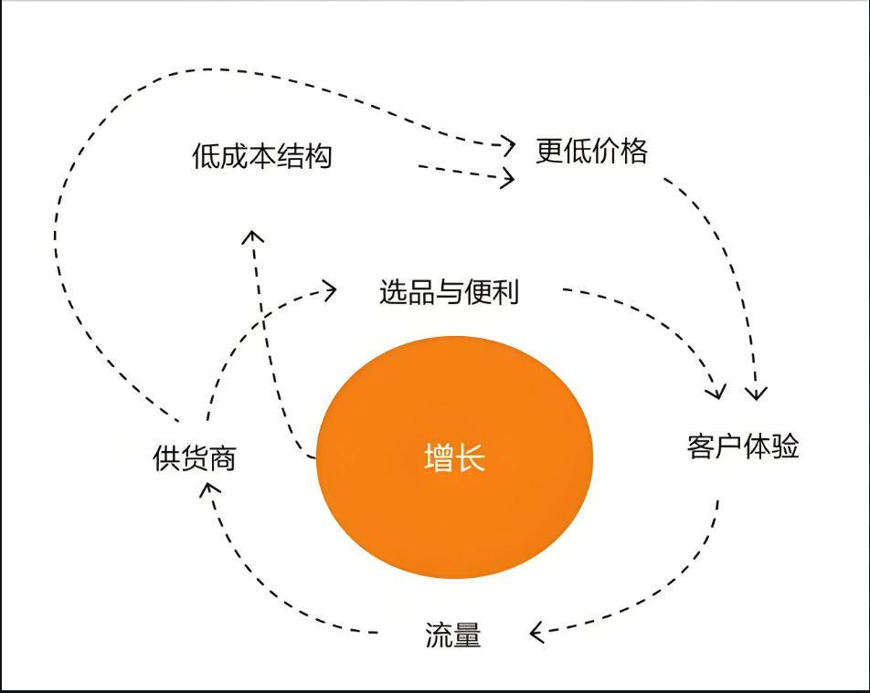

# 一、平台介绍

## **平台背景**

- **成立时间**：1994年，由杰夫·贝索斯（Jeff Bezos）在美国西雅图创立。
- **发展历程**：起初是一家在线书店，逐步扩展到全品类电商平台；如今已成为全球最大电商和云计算企业之一。
- **全球布局**：在美国、欧洲、日本、澳大利亚、中东等拥有多个站点和运营中心。

## **业务模式**

亚马逊的电商业务主要包括以下两种：

1. **1P模式（自营模式）**

- 亚马逊直接向品牌/供应商采购商品，以零售商身份销售给消费者（类似传统零售）。

1. **3P模式（第三方卖家平台）**

- 卖家在亚马逊平台开店，直接向消费者销售，亚马逊收取佣金及其他服务费用。
- 目前3P卖家销售额已占亚马逊零售GMV的一半以上。

## 卖家类型

1. **个人卖家**：无需注册公司，适合小规模测试销售。
2. **专业卖家**：需要营业执照等资质，适合大规模运营。
3. **品牌卖家**：完成品牌备案，可使用A+内容、品牌分析等高级功能。

## 核心竞争力

- **庞大的用户基数**：全球活跃用户超过3亿。
- **Prime会员体系**：提升复购率与客户忠诚度。
- **强大的物流网络**：快速配送覆盖主要市场。
- **算法驱动的搜索与推荐**：提高转化率与客单价。

# 二、亚马逊飞轮

## **理论概述**

每一个跨境电商都有自己的核心理论，其中亚马逊的核心理论是飞轮理论，飞轮理论是由Amazon CEO贝佐斯早期提出的一个商业理论，一般可以通俗的解读为：**一个公司的各个业务模块之间会有机的相互推动，就像是咬合的齿轮一样。不过这个齿轮组从静止到转动起来需要花费比较大的力气，但是每一圈的努力都不会白费。一旦有一个齿轮转动起来，整个的齿轮组就会跟着飞速转动。**

具体机制体现为：**良好客户体验 → 吸引流量与卖家 → 商品丰富与低价 → 成本下降 → 更优服务与价格 → 再提升客户体验**，形成正循环。所以亚马逊的初心一直都是围绕以服务消费者为核心的企业。

## **亚马逊飞轮理论**的两个核心驱动因素

### **Prime会员权益**

- Prime会员是飞轮运转的主要动力之一。
- 在美国，Prime会员数量已超 8000 万，占总人口 25% 以上，也就是说每 4 个人里就有 1 个是Prime会员。
- 会员权益包括：更快的配送速度、免邮、优惠商品、大促好货、专属折扣等。
- 这些权益吸引消费者加入Prime，从而带动购买频率和消费金额的提升。

### **Marketplace商家服务**

- Marketplace允许第三方商家在亚马逊平台开店销售商品。
- 亚马逊通过Prime服务提升消费者体验，同时为第三方卖家提供FBA等物流仓储服务。
- 当卖家的商品进入Prime可选范围，会员商品池扩大，消费者选择更多；亚马逊配货量足时，成本下降，价格更具竞争力。
- 核心目标是通过这套机制**持续推动业务的快速增长**。

## **亚马逊飞轮理论的七要素**

1. 平台增长（扩大用户规模）
2. 卖家或供应商（扩大商品来源）
3. 产品选择及便利性（品类丰富和购物方便）
4. 买家/用户体验（购物流程顺畅）
5. 流量（用户访问量）
6. 低成本结构（通过规模缩减成本）
7. 低价格（以价促销带动销量）

可以从上面的内容看出亚马逊是一个闭环循环，只要是消费者需求一直在，这种循序就会一直都在，不会结束。这一飞轮理论的七要素是：平台增长、卖家/供应商、产品选择和便利、买家体验、流量、低成本结构和低价。但是其中买家、卖家、平台三个元素起着重要作用，三个元素，买家是飞轮的动力，平台是飞轮的框架，卖家是支的部件和齿轮他们之前相互合作，共同保持飞轮的快速增长。

亚马逊循环可以简单理解为：平台为消费者提供便利和物美价廉的优质服务，从而实现买家增长，买家增长即为流量，平台拥有足够多的流量时自然会吸引更多且优质的供应商加入，不仅丰富了商品种类，还引起了一定且合理的价格战争，让消费者享受到更加优质服务，提升消费者满意度一连锁过程将继续发生，整个亚马逊平台将继续沿着飞轮循环发展。

# 三、爆品、精铺、铺货等业务模式介绍

## **爆品模式**

**定义**：聚焦少数几个高潜力产品，通过极致优化和集中资源推广，快速打造销量爆款。

**特点**：

- 产品数量少，SKU精简。
- 高度依赖市场调研与差异化设计。
- 运营资源集中（广告、促销、A+内容等）。
- 爆发期销量大，但生命周期可能较短。

**优势**：

- 资源集中、ROI 高。
- 品牌化程度高，易形成壁垒。

**风险**：

- 单品依赖风险大，一旦销量下滑会直接影响整体业绩。
- 竞争者快速跟进，价格和流量压力大。

**适用卖家**：

- 有较强选品能力、供应链和产品优化能力的团队。

## **精铺模式**

**定义**：选取一定数量（中等规模）的产品，保持适度的SKU数量，在精细化运营和市场覆盖之间取得平衡。

**特点**：

- SKU数量适中（几十到几百）。
- 每个产品都有一定的调研和优化，但投入资源略少于爆品模式。
- 依赖数据驱动，根据表现持续优化SKU组合。

**优势**：

- 分散风险，避免单一产品依赖。
- 有一定规模效应，又能兼顾运营深度。

**风险**：

- 需要较强的数据分析与库存管理能力。
- 每个产品资源分配有限，爆发力可能弱于爆品模式。

**适用卖家**：

- 已有一定运营团队规模、能平衡多产品管理的中型卖家。

## **铺货模式**

**定义**：大规模上架SKU，通过数量覆盖市场，依赖自然流量和少量广告带动销量。

**特点**：

- SKU数量庞大（几百到几千甚至上万）。
- 选品速度快、成本低（可借助ERP或采集工具）。
- 以试错和流量覆盖为核心策略。

**优势**：

- 快速占领多个市场、类目。
- 单品销量要求低，靠整体规模盈利。

**风险**：

- 管理难度大（库存、侵权、质量控制）。
- 容易触发平台政策风险（重复铺货、低质Listing）。
- 广告预算分散，单品竞争力弱。

**适用卖家**：

- 初期资金有限但有自动化工具、想快速测试市场的卖家。