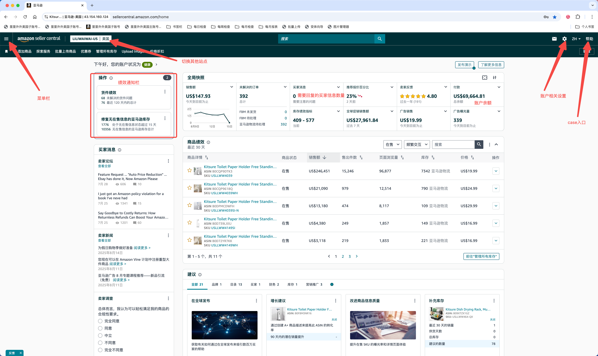
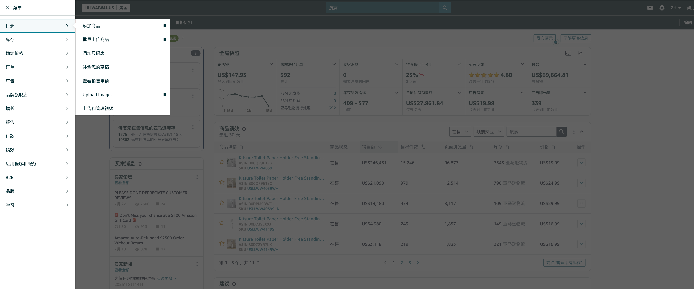
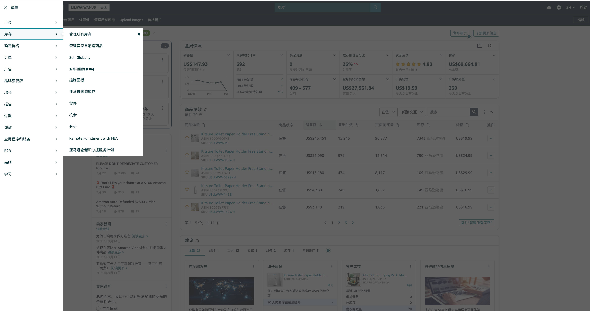
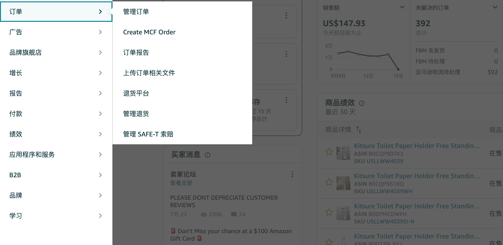
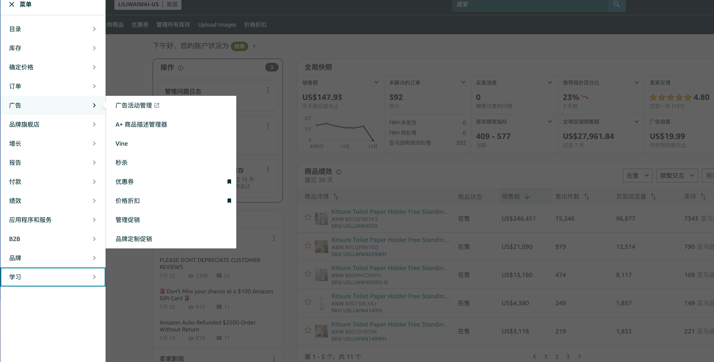
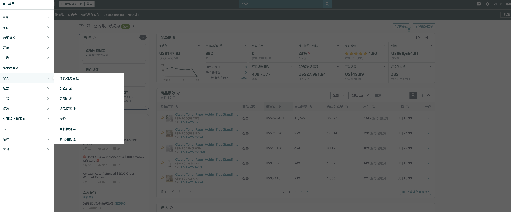
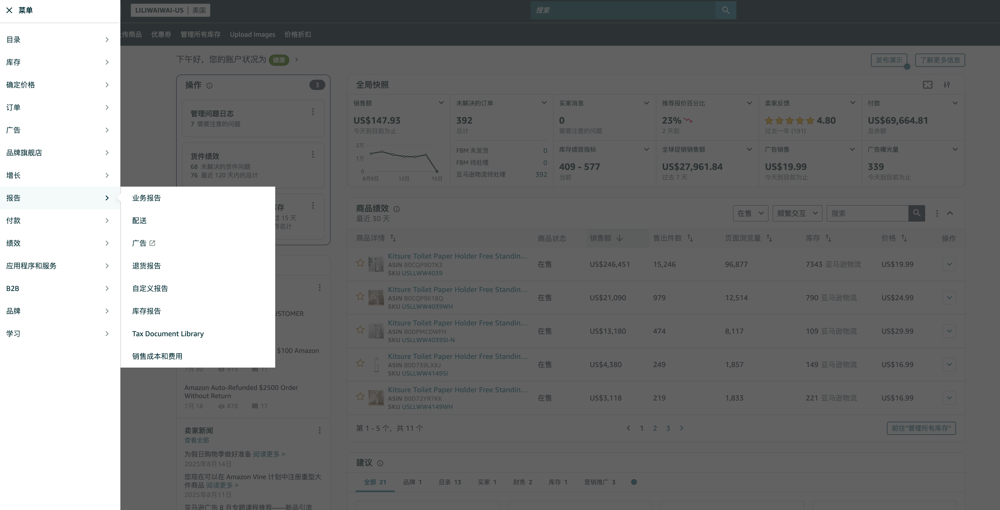
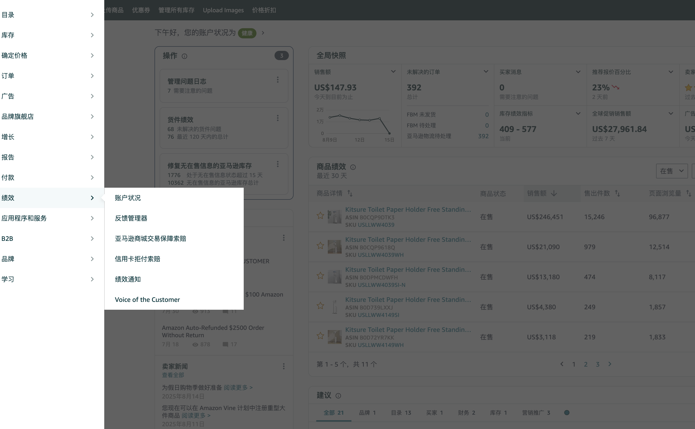
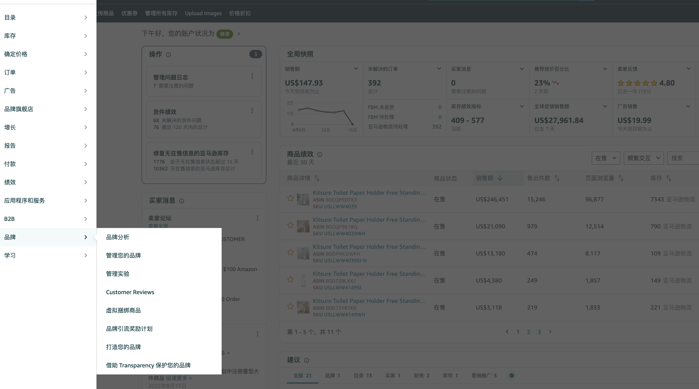

# 亚马逊操作界面后台介绍

## 一、首页

## 二、菜单栏

### **目录**

- **添加商品：**用于创建新的Listing，填写标题、价格、库存、图片等信息，把产品上架到亚马逊平台。
- **批量上传商品：**通过上传Excel/CSV模板，一次性上架多个商品，适合SKU数量较多的卖家。
- **添加尺码表：**给服装、鞋类等商品添加详细的尺码信息，让买家更容易选择合适的规格。
- **补全您的草稿：**进入之前保存但尚未完成上架的Listing草稿，继续编辑直至完成上架。
- **查看销售申请：**查看并管理需要申请销售许可的受限类目/品牌商品的审核进度和结果。
- **Upload Images：**为Listing上传或替换产品图片，支持主图、辅图等多角度展示。
- **上传和管理视频：**上传产品视频或品牌宣传视频，用于详情页展示，提升转化率。

### 库存

1. **管理所有库存**

- 查看并管理所有在售SKU的库存数量、价格、上架状态。
- 可以直接批量编辑价格、数量，也可下架或删除Listing。

1. **管理卖家自配送商品**

- 专门管理\*\*FBM（卖家自发货）\*\*的SKU库存和配送设置。
- 可批量更新库存、修改配送模板。

1. **Sell Globally**

- 跨境销售管理入口。
- 用于开通和管理其他亚马逊站点（如欧洲、日本、澳大利亚）销售权限。

1.  **亚马逊物流（FBA）**

- FBA综合功能区，进入后可查看与管理FBA业务相关的多个子页面。

- **控制面板**

  - 查看FBA总体表现（库存健康、入仓状态、费用等）。
  - 快速访问创建货件、补货建议。
- **亚马逊物流库存**

  - 查看当前在FBA仓库的库存数量、库龄、超龄库存比例。
  - 可进行移除、调拨等操作。
- **货件**

  - 创建和管理发往FBA仓库的补货货件。
  - 跟踪运输和入仓进度。
- **机会**

  - 系统推荐的潜在运营机会，如补货建议、优惠活动、促销机会等。
- **分析**

  - 查看FBA库存、销售、补货的统计分析和趋势。

1.  **Remote Fulfillment with FBA**

- 亚马逊的远程配送计划，可用美国FBA库存向加拿大、墨西哥等市场配送订单。

1. **亚马逊仓储和分拨服务计划**

- 针对需要大规模备货的卖家，提供亚马逊仓储+分拨至FBA仓的服务。

### 3.订单

**1.** **管理订单**

- 查看并处理所有买家订单（已下单、待发货、已发货等）。
- 可进行发货确认、更新物流单号、联系买家等操作。

**2.** **Create MCF Order**

- 创建**多渠道配送订单（MCF）**，让亚马逊FBA为来自其他平台（如eBay、独立站）的订单发货。

**3.** **订单报告**

- 下载订单数据报表，分析销售情况。
- 可用于财务对账、运营分析或库存管理。

**4.** **上传订单相关文件**

- 批量导入或更新订单信息，例如通过文件上传物流单号、发货状态等。

**5.** **退货平台**

- 亚马逊处理退货申请的入口。
- 查看买家退货原因、退货状态。

**6.** **管理退货**

- 卖家直接处理的退货订单管理页面（包括批准或拒绝退货、提供退货标签等）。

**7.** **管理 SAFE-T 索赔**

- **SAFE-T（Seller Assurance for Ecommerce Transactions）索赔**是FBM卖家用于申请因退货异常造成损失的赔偿通道。
- 卖家可在此提交索赔申请并跟进处理状态。

### 4.广告

**1.** **广告活动管理**

- 进入亚马逊广告平台，管理站内广告活动，包括Sponsored Products（商品推广）、Sponsored Brands（品牌推广）、Sponsored Display（展示广告）等。
- 可新建广告、查看广告表现数据、调整预算与出价。

**2.** **A+ 商品描述管理器**

- 为已完成品牌备案的商品创建A+内容（Enhanced Brand Content），用图文模块丰富详情页，提升转化率和品牌形象。

**3.** **Vine**

- 亚马逊官方测评项目，邀请Vine会员免费领取商品并撰写评价，用于积累早期优质Review。

**4.** **秒杀**

- 限时促销活动（Lightning Deal），在特定时段以优惠价出售商品，提升曝光与销量。

**5.** **优惠券**

- 创建优惠券（Coupons），买家领取后在结账时自动减免金额或百分比折扣。

**6.** **价格折扣**

- 设置直接的价格优惠（Percentage Off / Money Off），在商品页面直接显示降价信息。

**7.** **管理促销**

- 管理已创建的所有促销活动，包括打折、捆绑销售、满减等促销规则。

**8.** **品牌定制促销**

- 针对品牌旗下产品定制促销方案，通常配合品牌旗舰店和品牌活动使用。

### 增长

**1.** **商机探测器**

- 分析市场空白、需求增长的品类，帮助发现可进入的新市场或细分领域。

**2.** **多渠道配送**

- 即 MCF（Multi-Channel Fulfillment），用FBA库存为其他平台（eBay、独立站等）的订单发货。

### 6.报告

**1.** **业务报告**

- 查看销售、流量、转化率等核心运营数据。
- 可按日期、SKU、ASIN等维度细分分析。

**2.** **配送**

- 下载和查看订单配送相关的报告，例如配送状态、FBA入仓进度等。

**3.** **广告**

- 查看广告活动的投放效果，包括点击率、转化率、广告花费等。
- 直接跳转至广告平台查看详细数据。

**4.** **退货报告**

- 提供退货数据，包括退货原因、退货数量、退货率等，用于分析产品质量与售后表现。

**5.** **自定义报告**

- 卖家可按需要选择数据字段、过滤条件，生成个性化的运营或财务报告。

**6.** **库存报告**

- 提供FBA和FBM库存的详细情况，包括可售库存、在途库存、库龄等。

**7.** **Tax Document Library**

- 税务文件库，存放和下载与税务相关的文件，如发票、税表、税务报告等。

**8.** **销售成本和费用**

- 查看销售中产生的各种成本明细（FBA费用、广告费、佣金等），用于利润核算。

### 7.绩效

**1.** **账户状况**

- 查看店铺的整体绩效，包括订单缺陷率、延迟发货率、政策合规状态等。
- 是判断账号安全性和是否有被封店风险的重要入口。

**2.** **反馈管理器**

- 查看和管理买家对卖家的**卖家反馈**（不同于商品评论），可请求删除或申诉不合理反馈。

**3.** **亚马逊商城交易保障索赔**

- 针对买家通过**A-to-Z保障**提出的索赔请求进行查看和处理，避免不必要的扣款和绩效影响。

**4.** **信用卡拒付索赔**

- 买家向信用卡公司申请拒付（chargeback）时的处理中心，可以提供证据进行抗辩。

**5.** **绩效通知**

- 查看亚马逊发送的违规提醒、政策变更、绩效问题等通知，是风险管理的重要渠道。

**6.** **Voice of the Customer（客户之声）**

- 查看买家对产品体验的满意度反馈，包括“非常满意、满意、中立、不满意”等数据，用于改进产品与服务。

### 8.品牌

1. **品牌分析**

- 查看品牌相关的市场数据和竞争分析。

1. **管理您的品牌**

管理品牌备案信息和内容。

1. **管理实验**

- 测试不同标题、图片等内容对转化率的影响。

1. **Customer Reviews**

- 查看并管理品牌商品的买家评论。

1. **虚拟捆绑商品**

- 为已有商品创建虚拟组合销售。

1. **品牌引流奖励计划**

- 通过站外引流获得佣金返还。

1. **打造您的品牌**

- 亚马逊提供的品牌建设和营销资源。

1. **借助 Transparency 保护您的品牌**

- 通过Transparency防伪码防止假货销售。