# 亚马逊新品/新变体建单和跟卖SOP
# 一、新品/新变体建单流程

说明：新品/新变体是由计划运营创建链接并填写基础商品信息，推广运营负责上传主图、套图、文案信息，且后续的链接广告、折扣、活动也是推广运营负责。

## 1. 建单前准备

在创建 ASIN 前，需要准备以下资料：

- UPC码或申请好的UPC豁免
- 产品基础信息（SKU、品名、品牌、尺寸、材质等）
- 产品包装信息（尺寸、重量）
- 标题、五点描述与长描述文案
- 发货国家

## 2. 建单方法一：手动建单（通过空白表单逐个上传）

适用场景：少量新品上线、新手操作、无需复杂变体

- **步骤1：**卖家平台 → 目录 → 批量上传商品 → 空白表单 → 开始

- **步骤2：**输入商品名称（标题） **→** 确认商品类型是否正确 → 点击确认

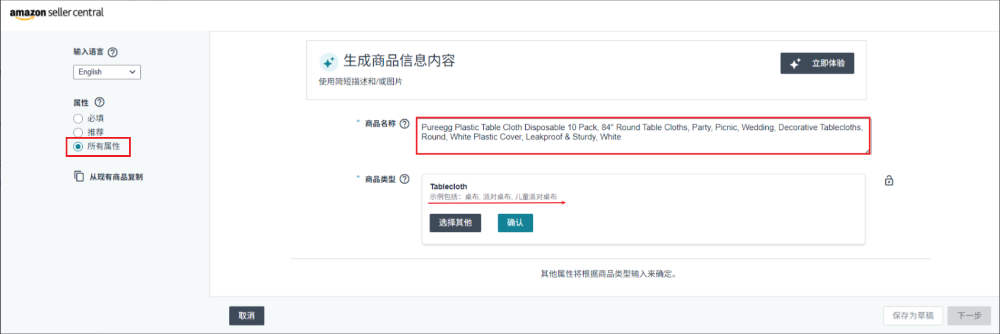

- **步骤3：**选择节点 → 填写品牌名 → 勾选“我没有商品编码”  → 点击下一步

- **步骤4：描述** → 填写产品描述（详情） → 填写五点描述（需点击“添加更多”添加至五个）

- **步骤5：产品详情** → 红框为必填项 

<callout emoji="🏰">
**其中以下几点需注意：**
</callout>

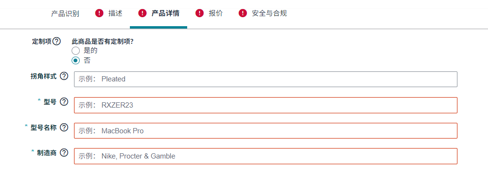

1）\*型号 / 型号名称：SKU （如US12200 或 PEP0ZB204-2-BL）

2）\*制造商：品牌名 （如Pureegg）

---

3）\*产品数量：填写对应产品数量

---

4）产品网站发布日期：填写未来日期 （如1/1/2026）

- **步骤6：**报价 → 红框为必填项 

<callout emoji="🐈">
其中以下几点需注意
</callout>

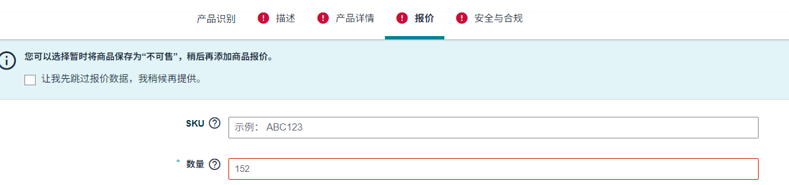

1）SKU（必填项）： 填写MSKU （如USPE12205GD-12 或 USLYT.0ZB210-6R-WH）

2）数量：该字段默认标记为红框必填项  
 如果选择 **“亚马逊将配送并提供客户服务（FBA）”**，系统会自动将该字段变为非必填项，无需填写  
 此设置需先将页面下拉至相应配送方式选项，勾选后生效。

---

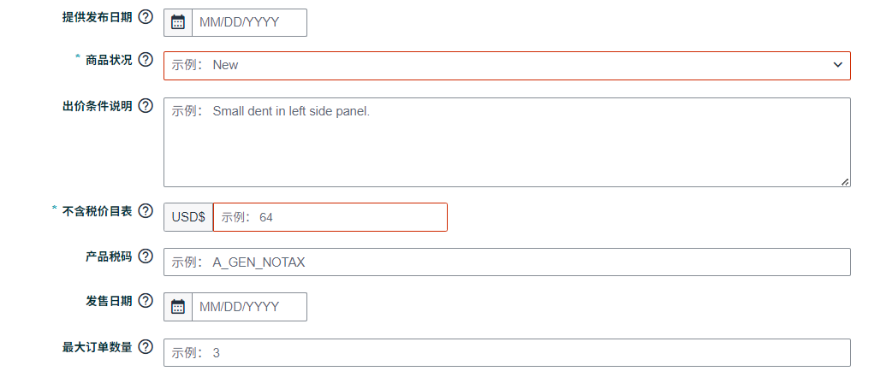

3）提供发布日期 / 发售日期：填写未来日期 （如1/1/2026）

4）商品状况：New

5）最大订单数量：该字段建议先填写 **2** 或 **3**。  
 该值可根据实际推广需求调整，必要时可先与推广运营沟通后再确定最终填写数量

---

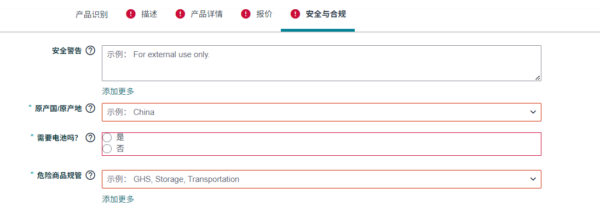

6）\*原产国 / 原产地：China

7）\*需要电池吗：否 （或根据实际产品填选）

8）\*危险商品规管：Not Applicable / 不适用 （或根据实际产品填选）

**特点**：

- 可视化操作流程，表单一步步填写
- 系统自动显示当前类目需要填写的字段
- 支持上传图片、创建父子体变体
- 新手更容易上手，出错率低

**注意事项**：

- 适合单品、少量产品操作；
- 如果使用UPC豁免，需在此流程中选择“我没有产品ID”并输入申请通过的品牌名；
- **图片上传**：初始建单阶段**不要上传任何商品图片**，以避免链接提前曝光或被系统抓取审核。

> 由于空白表单建单会引导卖家在流程中直接上传图片，因此**不建议在新品初始建单时使用空白表单**。  
> 推荐使用\*\*批量建单模板（Flat File）\*\*方式进行操作，可更灵活控制图片上传的时间节点。

## 3. 建单方法二：批量建单（通过电子表格上传）

适用场景：大批量上架商品、系统化运营、类目标准明确

**操作路径**：

- **步骤1：**卖家平台 → 批量上传商品 → 电子表格 → 下载空白模板

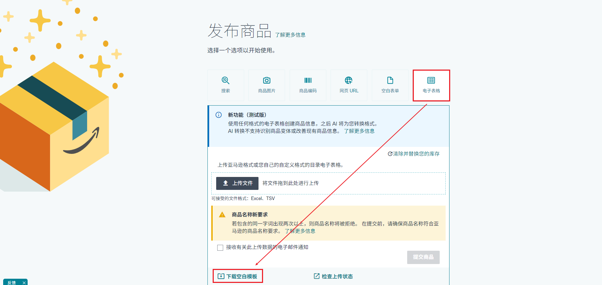

- **步骤2：**更新商品详情-点击“了解更多信息” → 点击“商品模板” → 选择表格语言-输入搜索商品类型 → 下载空白模板

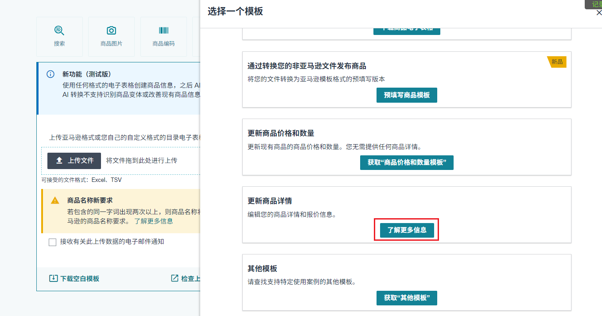

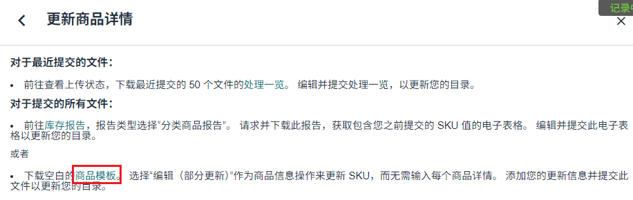

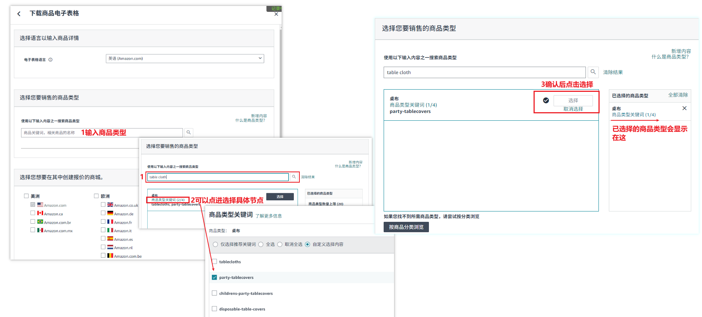

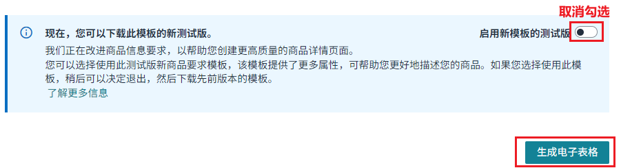

- **步骤3：**填写表格

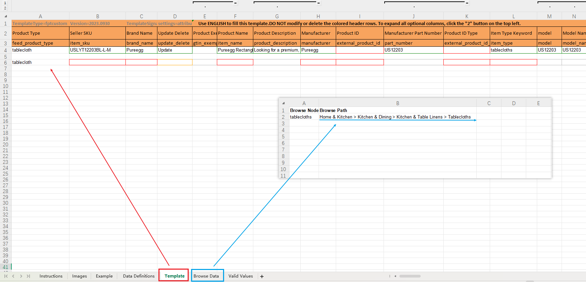

💡 温馨提示：产品类别和站点不同，表格填写内容也不同～以下列出的是所有类目和国家都必填的注意事项，请参考填写。

1）\*Product Type / feed_product_type：选择商品类型后会出现红框必填项和橙框推荐填写项

2）\*Seller SKU / item_sku：即MSKU

3）\*Brand Name / brand_name：品牌名 （如Pureegg），可下拉选择

4）\*Update Delete ：下拉选择“Update”

5）\*Product Name / item_name：标题

6）\*Product Description ：产品详情

7）\*Manufacturer / 制造商：品牌名 （如Pureegg）

8）Product ID / external_product_id ：首次建单无需填写，后续填写建单成功后生成的产品ASIN

9）Product ID Type / external_product_id_type：首次建单无需填写，同8）填写时下拉选择“ASIN”

10）part_number / model / model_name / 型号：SKU （如US12200 或 PEP0ZB204-2-BL）

11）\*Your Price / standard_price：按需求填写价格

---

\*Key Product Features / bullet_point1-5：五点

---

产品尺寸：请在左侧深蓝色区域填写，注意使用正确单位

包裹尺寸：请在右侧青蓝色区域填写，注意使用正确单位

---

1）\*Country/Region of Origin / 原产国：China

2）\*batteries_required / 需要电池吗：No （或根据实际产品填选）

3）\*supplier_declared_dg_hz_regulation1 / 危险商品规管：Not Applicable（或根据实际产品填选）、

---

1）merchant_shipping_group_name / 物流配送模板：Migrated Template（亚马逊配送）

2）currency / 货币：或根据实际下拉选择

3）list_price：按需求填写价格

4）product_site_launch_date / 产品网站发布日期：填写未来日期 （如2026/1/1）

5）merchant_release_date / 发售日期：填写未来日期 （如2026/1/1）

6）offering_start_date / 提供发布日期：填写未来日期 （如2026/1/1）

7）condition_type / 商品状况：填New

8）\*item_package_quantity / ipq：填写实际产品数量，必填项，填写后无法修改

9）max_order_quantity / 最大订单数量：该字段建议先填写 **2** 或 **3**。

6）number_of_items ：填写实际产品数量

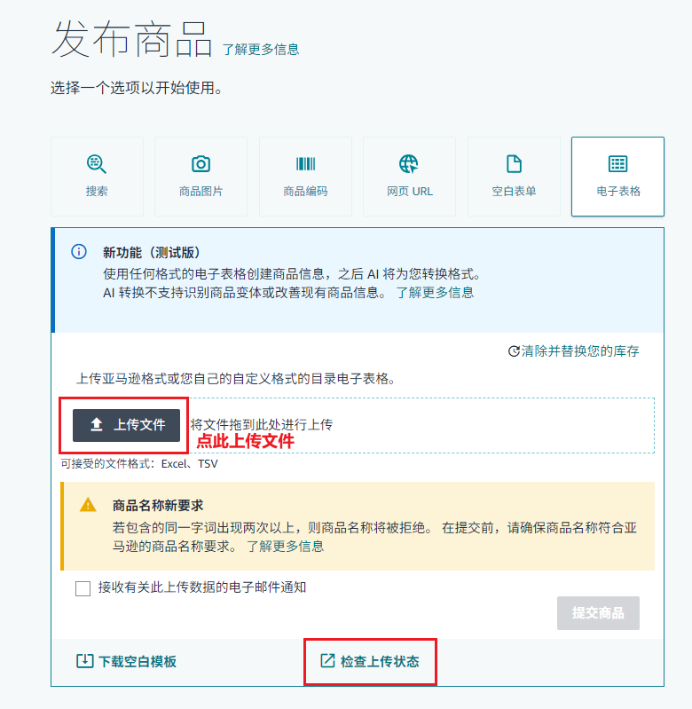

1）点击上传文件

2）可点击“检查上传状态”查看上传进度情况

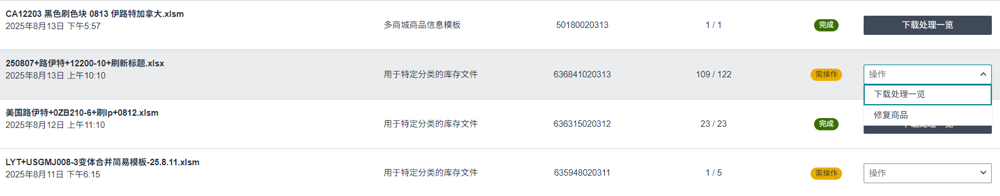

3）若显示“完成”则上传成功

     若显示“需操作”，可点击“操作”-“下载处理一览”查看失败原因

---

**优点**：

- 可一次性上传大量商品
- 更适合运营规范、SKU数量多的团队管理
- 易于复制粘贴已有数据，效率高

**注意事项**：

- 类目不同，字段差异较大，需确保使用**正确节点的最新模板**
- 上传失败需根据报告修改错误重新提交

# 二、UPC豁免流程

## 1. UPC豁免定义

在亚马逊平台上，UPC（通用产品代码）是产品创建时默认要求的商品编码，用于标识产品的唯一性。然而，对于某些品牌或特定品类，亚马逊允许卖家申请UPC豁免（UPC Exemption），即在创建商品时无需提供UPC码。

## 2. 为什么需要申请 UPC 豁免？

- 品牌未注册 UPC 码：部分品牌尚未为产品生成官方 UPC 条码。
- 自有品牌或定制商品：自有品牌、自产产品等并不具备通用的零售条码。
- 节省成本：避免额外购买UPC码的费用，特别是大批量新品上架时。

## 3. 申请UPC 豁免的条件

- 品牌已在亚马逊备案（Brand Registry），或品牌名称为“Generic”（无品牌）。
- 提供符合要求的产品图片，图片中不显示UPC条形码。
- 类目支持豁免，部分类目仍强制要求UPC。

## 3. 操作步骤

- **步骤1：**卖家平台 → 批量上传商品 → 空白表单 → 开始

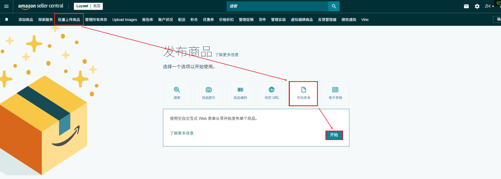

- **步骤2：**输入商品名称（标题） **→** 确认商品类型是否正确 → 点击确认

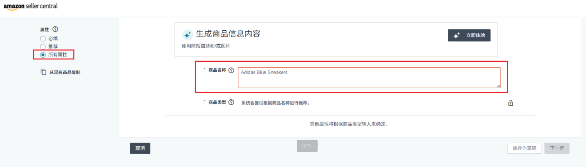

- **步骤3：**选择节点 → 填写品牌名 → 勾选“我没有商品编码”  → 点击下一步

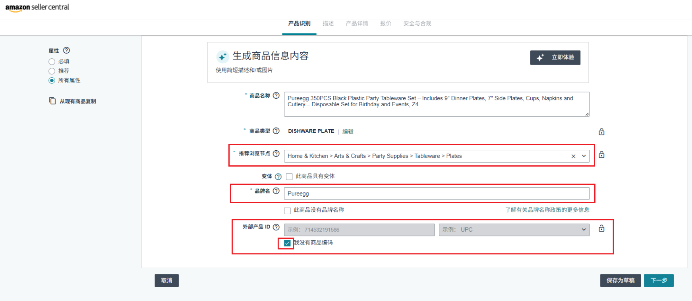

- **步骤4：**显示UPC豁免已核准 → 等待后即可正常建单

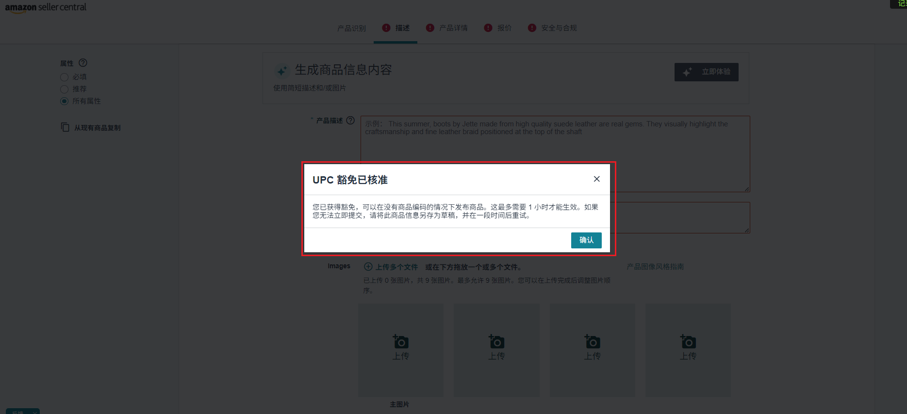

## 4. 注意事项与失败原因

- 每个“品牌+类目”组合需单独申请
- 图片中不能出现条形码或其他零售包装信息
- 常见失败原因包括品牌不符、图片含条码、类目不支持等

# 三、跟卖流程（Listing 跟卖流程）

## 1. 跟卖的定义与适用场景

**跟卖定义**：  
 跟卖（Listing Hijack / Piggyback Listing）是指卖家在已有 ASIN 页面下挂自己的商品库存，无需重新创建 ASIN，也不改变原有产品信息。跟卖可让卖家快速进入热销商品市场，分享已有流量和客户基础。

**适用场景**：

1. **品牌非独家控制商品**

   - ASIN 所属品牌允许多卖家销售，不属于严格品牌授权或独家控制。
2. **热销产品或热门类目**

   - 跟卖已有销量和流量的 ASIN，可快速获取订单，减少推广成本。
3. **快速测试新品或拓展市场**

   - 对类目或市场不熟悉的卖家，可通过跟卖方式测试定价、销售速度和市场反馈。
4. **库存或物流优势明显**

   - 卖家能提供更快发货、FBA配送或更低价格，增加竞争优势并争取 Buy Box。

## 2. 跟卖操作步骤

**操作路径：**

- **步骤1：**卖家平台 → 目录 → 批量上传商品 → 商品编码 → 搜索需跟卖ASIN

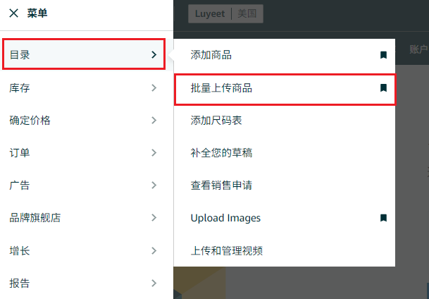

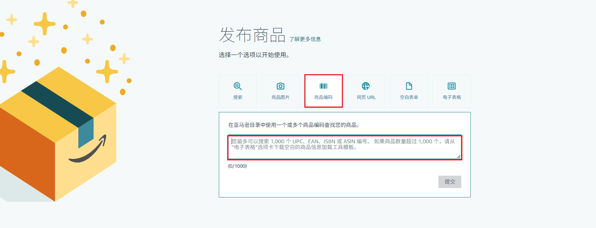

- **步骤2：**输入商品名称（标题） **→** 确认商品类型是否正确 → 点击确认

1）SKU（必填项）： 填写MSKU （如USPE12205GD-12 或 USLYT.0ZB210-6R-WH）

2）数量：该字段默认标记为红框必填项  
 如果选择 **“亚马逊将配送并提供客户服务（FBA）”**，系统会自动将该字段变为非必填项，无需填写  
 此设置需先将页面下拉至相应配送方式选项，勾选后生效。

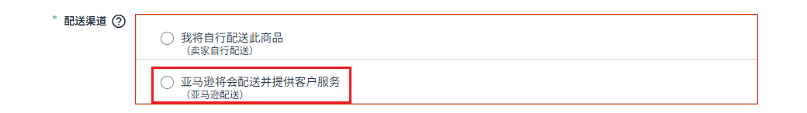

---

3）SKU（必填项）：按需求填写价格

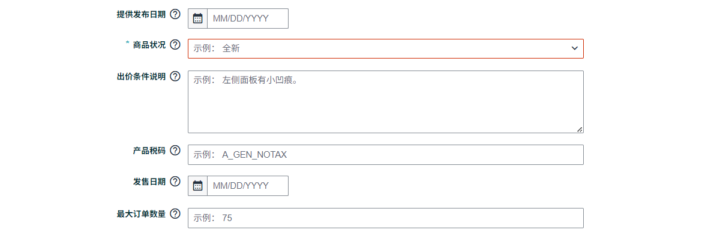

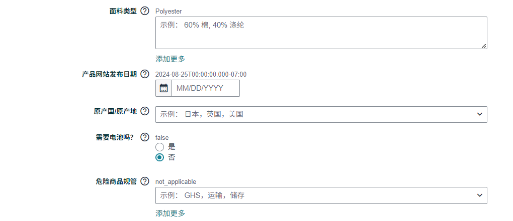

1）商品状况：新

2）提供发布日期 / 发售日期 / 产品网站发布日期：填写未来日期 （如1/1/2026）

3）最大订单数量：该字段建议先填写 **2** 或 **3**。  
 该值可根据实际推广需求调整，必要时可先与推广运营沟通后再确定最终填写数量

4）\*原产国 / 原产地：China

5）\*需要电池吗：否 （或根据实际产品填选）

6）\*危险商品规管：Not Applicable / 不适用 （或根据实际产品填选）

## 3. 跟卖注意事项

- 不可跟卖品牌强控 ASIN（如 Apple、Nike 等）
- 跟卖必须保证产品一致性，避免误导消费者
- 控制价格策略，防止恶性价格战
- 若有 Buy Box，销量更有保障

## 4. 常见问题处理

问题：无法跟卖  → 检查是否为品牌强控 ASIN、类目限制等

问题：被品牌投诉 → 立即下架商品，提交产品证明（发票/合同）

问题：无 Buy Box → 检查价格、发货方式、账号表现