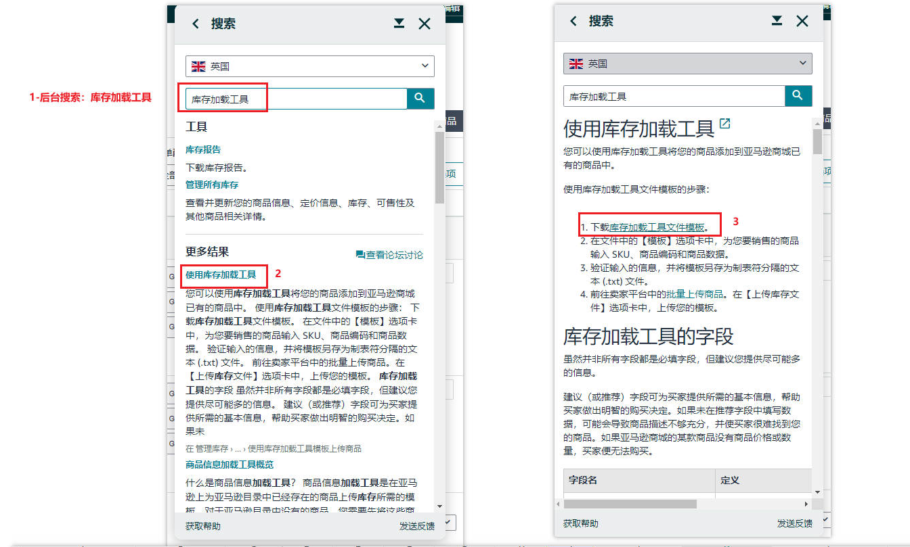
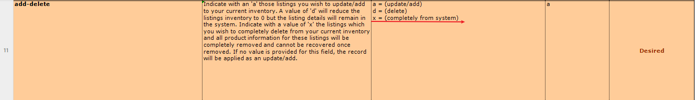
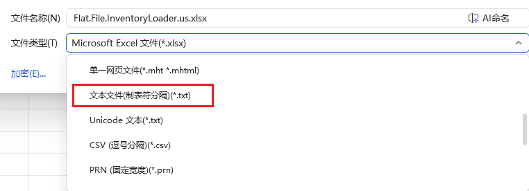
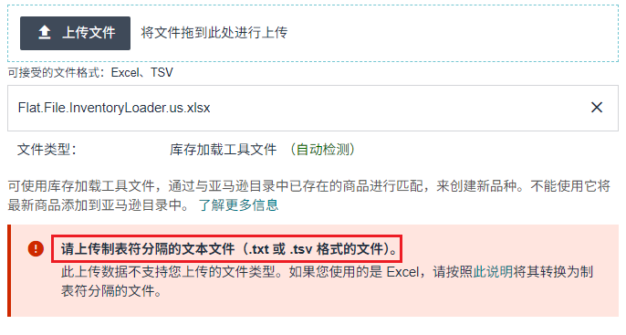
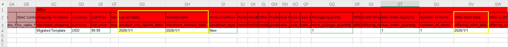
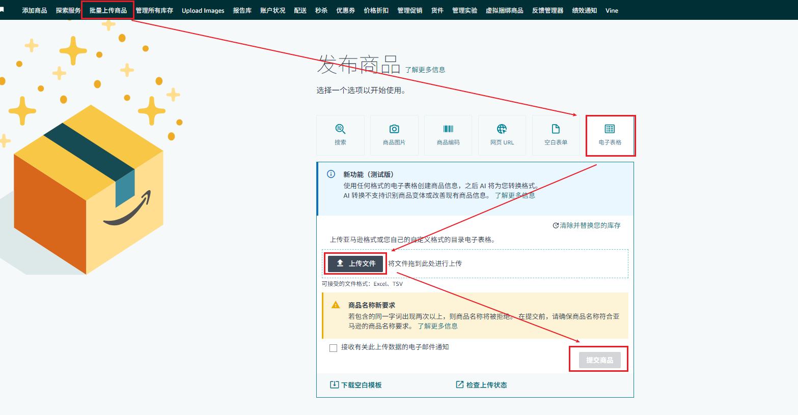
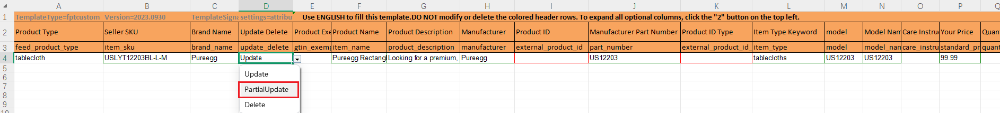

# 一、适用场景

删除链接和更新开售日期、尺寸信息都是计划运营在新链接发货过程中可能遇到的操作。均采用的是**部分更新**的方式。删除链接主要在于链接创建有误，或是链接创建多余时出现，更新开售日期及尺寸信息主要在于物流创建货件时遇到产品下架或是分配尺寸库存不对的情况。

# 二、删除链接

**操作路径：**

##### 1）后台搜索：库存加载工具

##### 2）根据Data Definitions模板填写信息

product-id-type：1=ASIN

add-delete：x = (completely from system)

##### 3）必填项（四个关键字段）

- sku：MSKU
- product-id：ASIN
- product-id-type：1
- add-delete：x

##### 4）另存为（制表符分隔）.txt

请注意上传需要将文件另存为**制表符分隔的文本文件（.txt 或 .tsv 格式的文件）**

- 当上传为错误格式文件时：

# 三、修改更新信息并上传

## 更新开售日期

#### 1. 亚马逊商品日期字段说明

**1）Product Site Launch Date**（商品上线日期）

- 定义：商品在亚马逊前端展示页面正式对买家可见的日期。
- 用途：控制新品展示上线时间，影响搜索和营销活动的可见性。

**2）Merchant Release Date**（商家发售日期 / 上市日期）

- 定义：卖家计划开始销售该商品的日期。
- 用途：可用于内部库存管理和计划运营，通常作为物流和推广计划的参考。

**3）Offering Start Date**（商品报价开始日期）

- 定义：商品在亚马逊系统中允许创建报价（Offer）的日期。
- 用途：决定卖家可以开始提交价格、库存信息以及参与促销活动的起始时间。

#### 2.操作路径：

1）打开建单表格

2）update_delete：选择“PartialUpdate”，部分更新

3）修改开售日期

4）上传表格

## 修改尺寸信息

#### 操作路径：

1）打开建单表格

2）update_delete：选择“PartialUpdate”，部分更新

3）修改对应尺寸信息

产品尺寸：请在左侧深蓝色区域填写，注意使用正确单位

包裹尺寸：请在右侧青蓝色区域填写，注意使用正确单位

4）上传表格

