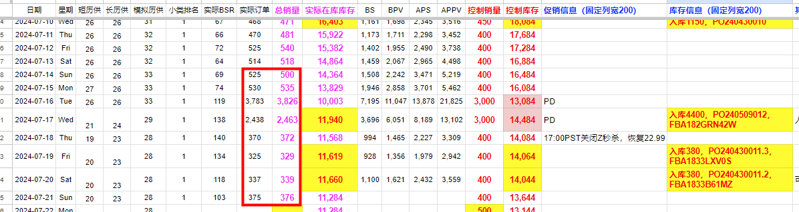
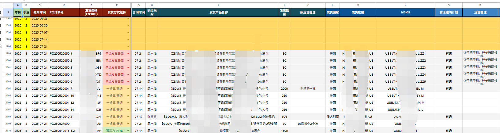

# 一、盘点现有库存

## 1、先确认FBA库存、在途库存、工厂订单

**原方法（表格数）：**

打开“销量模拟+库存控制”表

1）确认工厂生产。目前采用“销量模拟+库存控制”表，确认对应SKU近期时点前后订单是否填写，是否已经建单发货，确认完后，根据已下单未发货的订单即为工厂生产订单。

2）盘点FBA库存

a.目前采用“销量模拟+库存控制”表，先将近期对应的销量情况填写清楚；

b.盘点近期即将入库的订单，确认是否已入库接收。确认的方式是将近期即将入库的订单查找对应的FBA货件单号，如FBA182GRN42W，上后台“库存-货件”或是AK“FBA-FBA货件”确认是否已入库接收；若已接收，则登记入库并在【实际在库库存】、【控制库存】中添加对应数量。若未接收，则根据预估入库时间列为在途库存。

c.上述操作完后【实际在库库存】即为明确FBA库存。

3)盘点在途库存

其余已发货未入FBA库存即为在途库存合计

# 二、确认推广计划及销量预估

## 1、明确推广计划：

让推广明确期间的销量预估，包含日常控制销量、日常促销、大促、种子链接、断货情况等综合考虑，目前销量预估采用“销量模拟+库存控制”表中【控制库存】字段。

## 2、备发货大逻辑

整体大逻辑为：

发货时间点=预估售罄日期-安全库存时间-货运周期

补货数量=补货频次\*控制日销

补货频次=7天或14天

细化库存规划基本大逻辑可参考如下文档内容：

**库存规划**（原件未收录，见飞书）

## 3、确认补货时点、补货数量、船期货运情况

1）安全库存时间：通常保持在35天，指的是FBA库存可销售时间（具体视产品情况和推广计划调整）；

2）货运周期可沟通物流一起确认，这边的货运周期影响除客观天气等因素外还主要受多方面影响：a.亚马逊仓库位置（美西、美中、美东等）；b.亚马逊拆货方式（可查询 9 亚马逊相关费用介绍 中的 入库配置服务费）；c.货运方式（普船、快船、空运、铁路）。

3）生产周期可沟通执行采购和工厂确认；

4）补货频次通常为14天，视产品稳定性确认拉长或减少（具体量视产品情况和推广计划调整）；

5）补货数量可能会受商品起订量影响，可拆分批次发货。

# 三、根据上述的数据信息情况撰写“库存盘点表格”和提交发货计划审批

提交审批计划，由营销中心总监李昆审批

# 四、明确信息

明确对应发货店铺、发货产品、发货数量、发货MSKU/FNSKU、发货方式（含仓库位置、拆货方式、货运方式）、是否有透明计划及额外备注点。

# 五、协同采购及物流明确最终发货计划

1、采购明确供应商交期是否能够满足；

2、物流明确货代发货是否能够满足；

3、最终协同达成一致，按最终计划安排发货。