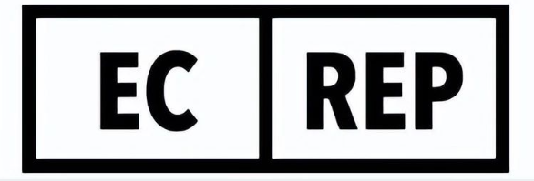
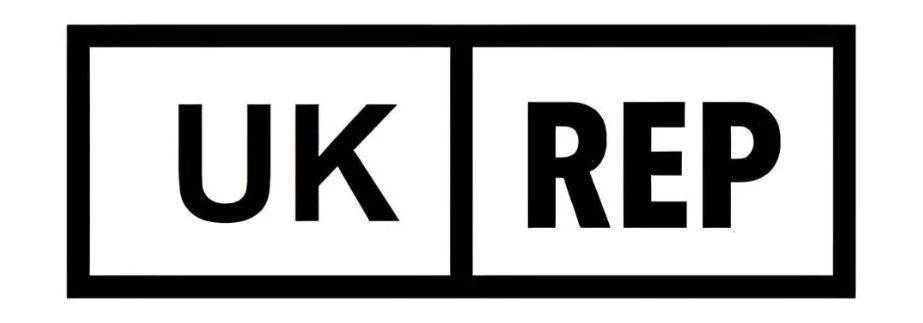
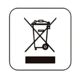
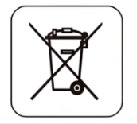
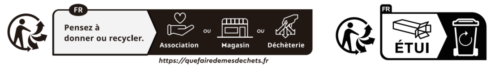
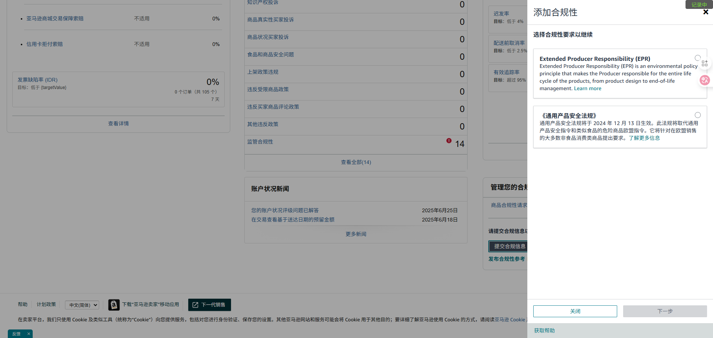
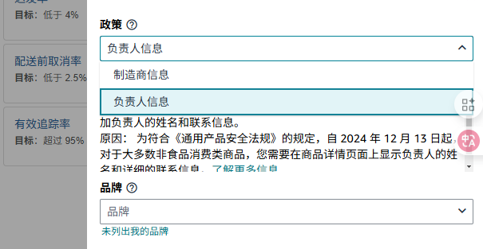

# 一、目的

      欧洲市场以其庞大的消费潜力和成熟的电商环境，随着对欧洲等站点国家的拓展，如何实现合规化运营，成为我们的跨境销售的重中之重。欧洲各国对于税务合规及环保合规的要求十分严格。VAT、EORI、EPR合规、GPSR合规等，这些看似复杂的合规要求，常常让不少跨境卖家望而却步，甚至因此遭遇货物滞留、罚款、店铺受限等风险，错失宝贵的市场先机。本文主要为大家提供欧洲合规核心三类型及其他合规事项相关说明。

# 二、欧洲合规包含内容

| **合规类型** | **合规要求（摘自公众号“萃欧”）** |
|-|-|
| **VAT** | 增值税注册、申报、发票管理。适用于**所有对欧销售行为**。 |
| **EORI** | 进出口必要的企业识别码，是**海关清关与物流**必备条件。 |
| **欧洲联系人（英代、欧代）** | 授权代表，负责进行对应境内相关**产品合规**的事务事项，需体现在**包材**上。 |
| **EPR合规** | 环保责任注册与申报。涵盖**包装**、WEEE、电池、纺织等品类。 |
| **GPSR合规** | 产品安全合规，涉及**贴标、欧代**、风险通知，特别是非食品类产品。 |
| INTRASTAT申报 | 欧盟货物流通统计申报，视交易量而定。 |
| 平台要求 | 如亚马逊VCS开票服务、发票缺陷率控制、EPR编号上传等。 |

# 三、VAT介绍（欧洲通行证）

## 1、定义

      欧洲VAT（Value Added Tax，**增值税**）是欧盟国家对商品和服务流通环节征收的间接消费税，由最终消费者承担，但由商家代缴。其核心逻辑在于多环节征收与进项税抵扣机制，确保税款仅针对最终消费环节。

      部分欧盟国家还有本土税号和欧盟税号的要求和区别，如西班牙的本土税号NIF和欧盟税号ROI，西班牙进行跨境销售强制要求需要有欧盟税号ROI，需单独沟通注册。

## 2、注册要求

      卖家符合以下条件的任一情况，就必须注册VAT：

1）有实物商品进入欧洲国家（含英国和欧盟，英国脱欧），需要进口清关；

2）在欧洲国家设有仓储，无论是海外仓或是FBA等平台仓；

3）B2B销售并提供企业发票；

4）注册欧洲国家企业；

5）跨境远程销售；

6）亚马逊泛欧计划。

## 3、税率

<table><colgroup><col/><col/><col/><col/><col/><col/><col/></colgroup><tbody><tr><td vertical-align="middle"><b>国家</b></td><td vertical-align="middle"><b>英国（UK）</b></td><td vertical-align="middle"><b>德国（DE）</b></td><td vertical-align="middle"><b>法国（FR）</b></td><td vertical-align="middle"><b>意大利（IT）</b></td><td vertical-align="middle"><b>西班牙（ES）</b></td><td vertical-align="middle"><b>其他</b></td></tr><tr><td vertical-align="middle"><b>税率</b></td><td vertical-align="middle">20%</td><td vertical-align="middle">19%</td><td vertical-align="middle">20%</td><td vertical-align="middle">22%</td><td vertical-align="middle">21%</td><td vertical-align="middle">欧盟等还有很多国家，可根据推广站点对应查询</td></tr><tr><td colspan="7" vertical-align="middle">部分国家有对应类目或是企业类型的低税率/豁免政策，可对应关注</td></tr></tbody></table>

## 4、常见注册资料

主要资料可沟通对应注册服务商获取，一般有如下资料：

1）中国公司营业执照；

2）法人身份证；

3）店铺后台截图（销售国家、卖家记号、FBA设置、链接截图等）；

4）欧洲本地联系人信息（英代、欧代）；

5）销售合同、发票等。

6）其他要求文件。

## 5、亚马逊后台备案登记

      亚马逊要求在卖家进行销售时需在后台备案登记对应国家的增值税（VAT）登记信息，包括增值税号和地址信息。具体登记界面在“亚马逊后台-设置-税务设置”。

      对应税务信息地址登记有如下要求：

需优先核对税证上相关地址和下述填写地址是否一致。

DE/CZ/PL/ES--选【注册地址】：填写对应实际营业注册地址；

FR/IT--选【财税代表】：填写对应税证税代地址；

GB--选【税务机构】：填写英国税务平台税务机构地址：

## 6、欧洲税务查询网址

1）英国：https://www.tax.service.gov.uk/check-vat-number/enter-vat-details

2）欧盟税号查询：https://ec.europa.eu/taxation_customs/vies/#/vat-validation

3）西班牙本土税号查询（西班牙需单独注册欧盟税号）：https://factura.city/validar-vat

## 7、亚马逊申报回执数据导出

欧洲VAT税务需要按对应周期时间进行税务申报，以确保税务合规及保障VAT税号的正常使用。一般为如下周期：

<table><colgroup><col/><col/><col/><col/><col/><col/><col/></colgroup><tbody><tr><td vertical-align="middle"><b>国家</b></td><td vertical-align="middle"><b>英国（UK）</b></td><td vertical-align="middle"><b>德国（DE）</b></td><td vertical-align="middle"><b>法国（FR）</b></td><td vertical-align="middle"><b>意大利（IT）</b></td><td vertical-align="middle"><b>西班牙（ES）</b></td><td vertical-align="middle"><b>其他</b></td></tr><tr><td vertical-align="middle"><b>申报周期</b></td><td vertical-align="middle">季度申报</td><td vertical-align="middle">月度/季度/年度</td><td vertical-align="middle">月度/季度</td><td vertical-align="middle">月度/季度</td><td vertical-align="middle">季度</td><td vertical-align="middle">欧盟等还有很多国家，可根据推广站点对应查询</td></tr><tr><td colspan="7" vertical-align="middle">对应申报截止时间可对应国家查询</td></tr></tbody></table>

亚马逊后台-菜单-报告-配送-税费-亚马逊增值税交易报告，按照对应需要申报期间导出即可。

西班牙会额外涉及税务发票的需求，对应导出地址为：亚马逊后台-菜单-报告-Tax Document Library-卖家费用税务发票（下载发票编号为 LU 开头、纳税人登记号为 ES 或 N 开头、商城为亚马逊的发票）

具体的核算方法可沟通对应负责财务或单独了解。

# 四、EORI介绍

## 1、**定义**

EORI（Economic Operators Registration and Identification）是欧盟为经济运营商（企业或个人）颁发的唯一海关识别码，用于进出口贸易中的身份识别与监管。其核心功能包括：

1. **清关必备**​：所有欧盟成员国要求进出口货物申报时必须提供EORI号，否则货物可能被扣留或延迟清关。
2. **税务关联**​：与增值税（VAT）绑定，用于进口增值税退税及税务申报。
3. **安全监管**​：海关通过EORI号追踪货物流动，提升贸易安全性。
4. **跨境通用**​：EORI号在欧盟全境有效，支持多国海关数据交换。

---

## 2、**EORI号的格式与组成**

EORI号由**国家代码（2位字母）+唯一标识符（最多15位字符）​**构成，例如：

- **德国**​：DE + 15位税号（如DE123456789012345）。
- **英国**​：脱欧后分为两种： 

  - **GB前缀**​：仅限英国境内使用（如GB1234567890000）。
  - **XI前缀**​：适用于欧盟27国（如XI123456789012）。
- **西班牙**​：ES + 9位税号（如ESB80000000）

# 五、欧洲授权代表（英代、欧代）

## 1、定义

**欧代（EU-Representative）​**  
 指欧盟授权代表，由欧盟境外制造商指定，负责在欧盟境内履行与产品合规相关的法律职责。适用于欧盟及欧洲经济区（EEA）市场，涵盖CE认证产品。

**英代（UK Authorized Representative）​**  
 英国授权代表，由英国境外制造商指定，负责处理英国市场内带有UKCA标志产品的合规事务。因英国脱欧后独立监管体系而设立。

## 2、核心职责对比

<sheet sheet-id="wn15En" token="L0R9s9LuLhZcLTtCaV4cxAcmnce"></sheet>

## 3、亚马逊备案要求

1、产品包装、说明书及电商后台（如亚马逊卖家中心）清晰标注英代/欧代信息；

2、GPSR备案要求：详见"[七、GPSR合规](https://fireeggs.feishu.cn/docx/Y5Xldg108op15lxYQCgcnTAhnzd#H1CRdVDCaorxbax8JpBcScJQnBo)"，亚马逊后台需备案填写。

# 六、EPR合规

## 1、定义

EPR（Extended Producer Responsibility，生产者责任延伸）是欧盟为落实环保责任而制定的强制性法规，基于“污染者付费”原则，要求生产者（包括制造商、进口商及销售商）对商品全生命周期的环境影响负责，尤其是产品废弃后的回收、处理及循环利用。其核心目标是通过经济与法律手段，推动企业减少资源消耗、降低污染，并建立可持续的循环经济体系。

## 2、**EPR的适用范围与分类**

**1）核心监管品类**

**a.包装类**​：所有商品的外包装（如纸箱、塑料膜）及运输包装。

**b.电子电气设备（WEEE）​**​：含电路或电源的电子产品（如手机、家电）。

**c.电池类**​：包括内置电池、可拆卸电池及纽扣电池。

**d.扩展类目**​（部分国家）：家具（法国）、纺织品（法国）、轮胎（西班牙）、一次性塑料（奥地利）等。

**2）适用国家与平台要求**

**强制国家**​：德国、法国、西班牙、奥地利、意大利、波兰等（具体类目因国而异）。

**平台合规**​：亚马逊、TEMU等平台要求卖家上传EPR注册号，否则商品将被下架或禁售。

**英国特殊要求**​：英国脱欧后需单独注册UK EPR，包装类由平台代扣代缴，其他类目需自主申报。

**包材要求：**部分产品包材上有EPR合规认证标签要求，如

德国包装法（视类目图案可能有细微区别，需具体确定）

WEEE电气法（视类目图案可能有细微区别，需具体确定）

电池法（视类目图案可能有细微区别，需具体确定）

法国家具法（视类目图案可能有细微区别，需具体确定）

## 3、**EPR合规的核心流程**

**1）注册与分类**

- **多国多类目注册**​：同一产品销往不同国家需分别注册（如德国包装法+WEEE，法国包装法+纺织品）。
- **资质文件**​：营业执照、产品技术文件、进口数据等。

**2）申报与缴费**

- **周期**​：按季度或年度申报销售数据（如法国EEE按设备类别申报）。
- **费用计算**​：根据材料类型（如塑料包装费率高于纸质）、销售量及重量确定。
- **平台代扣代缴**​：法国、西班牙部分类目允许平台代付，但需完成自注册备案。
- 部分类目申报核算可参照乐鱼服务商文件（感谢乐鱼）

<source name="乐鱼EPR各类别申报操作指引.pdf" mime="application/pdf" size="6192933" token="ZjKobb2JjoPqlxxkZ6QcB6nYn7b"/>

# 七、GPSR合规

GPSR合规详细问题解答可参照推文，感谢推文整理

<source name="全网最全！55个欧盟GPSR热门问答，卖家关心的难题都在这.pdf" mime="application/pdf" size="3590325" token="E8OJbX7TzokOb1xxZ7wcBKMXnng"/>

## 1、定义

GPSR（General Product Safety Regulation，通用产品安全法规）是欧盟针对非食品类消费品的强制性安全法规，于2024年12月13日正式生效，取代旧版《通用产品安全指令》（GPSD）。其核心目标是确保投放欧盟市场的消费品符合安全标准，保护消费者健康与安全，并强化企业责任。

## 2、适用范围

1）产品类别

- 覆盖范围​：所有未受特定**欧盟法规（如CE标志指令）**管辖的非食品消费品，包括电子产品、玩具、家具、服装、家居用品等。
- 豁免产品​：药品、食品、活体动植物、古董、航空器等。

2）地域范围

- 欧盟27国及北爱尔兰​：适用于通过任何渠道（含线上）销售的商品。
- 英国​：不适用于英格兰、威尔士和苏格兰，但北爱尔兰仍受约束。

## 3、核心合规要求

欧洲GPSR要求简要归纳为：**欧代**+产品认证（如需要）+**产品标签**（大部分产品都要）+**上传相关信息**（例如欧代信息、六面图等）至平台后台。

**1）产品认证**

- **安全标准**​：产品需符合欧盟协调标准（如EN标准）或通过风险评估证明安全性，涵盖设计、生产、使用及废弃全生命周期。
- **技术文件**​：制造商需保存产品描述、风险分析、测试报告、符合性声明等技术文件至少10年。

**2）标签与可追溯性**

- **标签内容**​： 

  - 欧盟负责人信息（名称、地址、联系方式）；
  - 制造商/进口商信息；
  - 产品批次/序列号；
  - 安全警告（使用销售国语言）；
  - 原产地信息（如“Made in China”）。
- **标签形式**​：可贴于产品、包装、包裹或随附文件，需永久印刷（不可仅用二维码替代）。

**3）欧盟负责人（欧代）​——具体内容可见“**[**五、欧洲授权代表（英代、欧代）**](https://fireeggs.feishu.cn/docx/Y5Xldg108op15lxYQCgcnTAhnzd#RtKAde3Hro0SV8xSABIcM0NCn3d)**”**

- **职责**​：作为制造商在欧盟的法定代表，负责接收监管通知、处理产品安全问题、保存技术文件等。
- **指定要求**​：非欧盟制造商必须指定欧盟境内实体（如欧代、进口商或履约服务商）作为负责人。

**4）召回与事故响应**

- **召回措施**​：需提供至少两种补救方案（维修、替换、退款），且不得向消费者收取费用。
- **事故报告**​：发现产品安全隐患时，需通过欧盟安全业务网关（Safety Business Gateway）向监管部门报告。

## 4、亚马逊平台上传要求

1）点击【绩效】→【账户状况】→【管理您的合规性】→右上角【添加合规信息】→【GPSR】→【下一步】；

2）下拉选择【GPSR-Responsible Person】→选择对应的品牌→点击【添加新的GPSR-Responsible Person】或从现有的信息中选择；

3）输入负责人（欧代）信息→【保存】→选中新添加的负责人信息→【保存】；

4）下方显示【已成功为XX品牌添加了负责人信息】→ 点击【完成】。