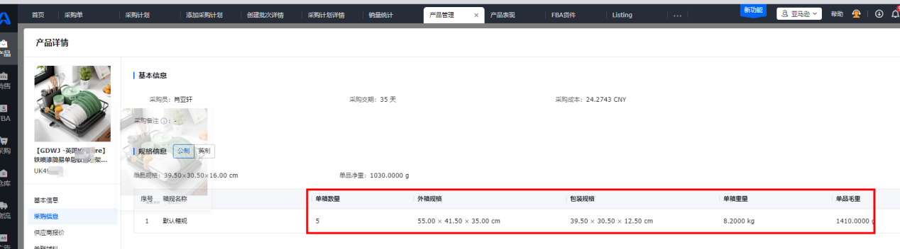
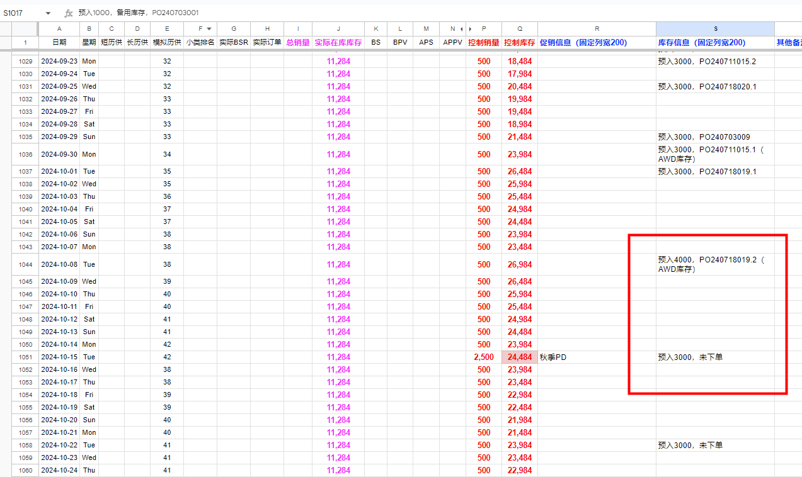
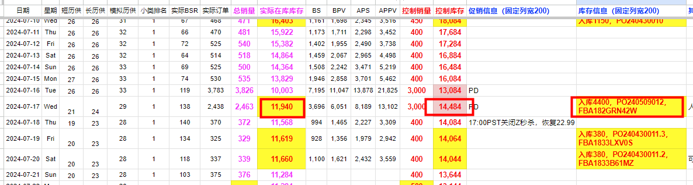
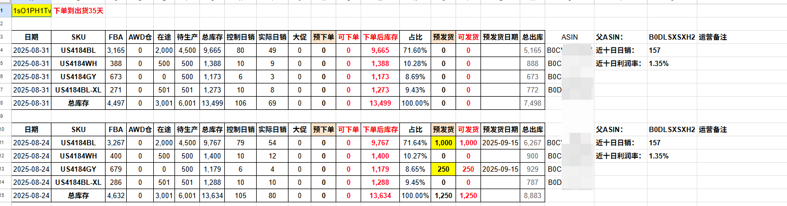
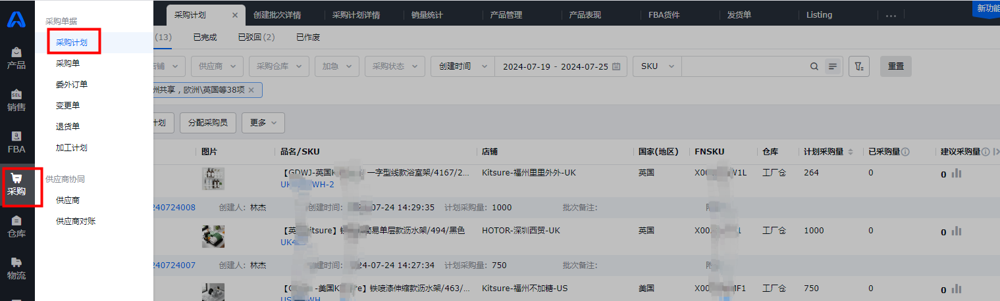
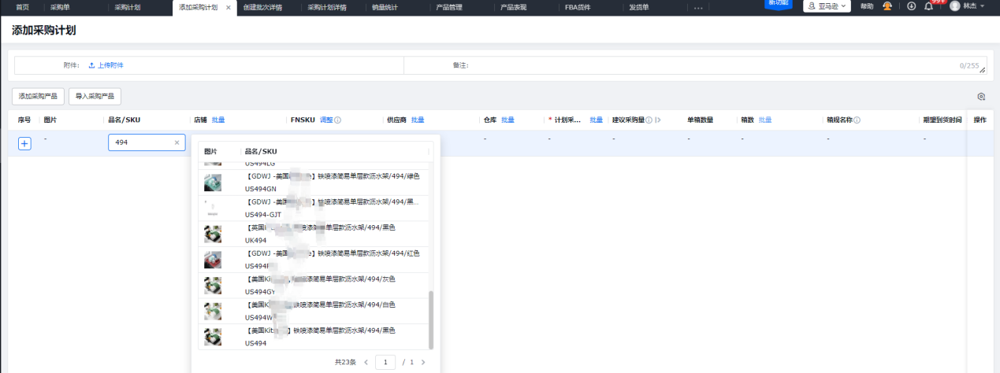
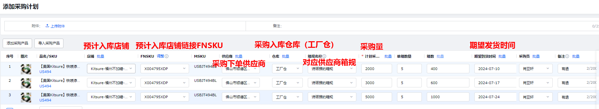

# 一、下单前需先确认如下建单和关联事项

1、需和**开发运营**确认新品流程是否已走完，AK产品管理是否已经建单SKU，若无，告知开发运营建单（新品AK建单由开发运营负责；后台MSKU(Listing)建单由项目运营负责）；

2、后台主店铺是否已经建链接，跟卖店铺是否已跟卖；

3、AK中“销售-Listing”中后台MSKU是否与AK产品管理建单SKU配对关联；若未关联，需先关联：

4、AK“产品管理”中对应下单SKU的采购信息是否完整，根据新品流程确认是否准确，若不完整需跟开发采购（开发运营）反馈补充完整；

# 二、盘点现有库存

## 1、先确认FBA库存、在途库存、工厂订单

**原方法（表格数）：**

打开“销量模拟+库存控制”表

1）确认工厂生产。目前采用“销量模拟+库存控制”表，确认对应SKU近期时点前后订单是否填写，是否已经建单发货，确认完后，根据已下单未发货的订单即为工厂生产订单。

2）盘点FBA库存

a.目前采用“销量模拟+库存控制”表，先将近期对应的销量情况填写清楚；

b.盘点近期即将入库的订单，确认是否已入库接收。确认的方式是将近期即将入库的订单查找对应的FBA货件单号，如FBA182GRN42W，上后台“库存-货件”或是AK“FBA-FBA货件”确认是否已入库接收；若已接收，则登记入库并在【实际在库库存】、【控制库存】中添加对应数量。若未接收，则根据预估入库时间列为在途库存。

c.上述操作完后【实际在库库存】即为明确FBA库存。

3)盘点在途库存

其余已发货未入FBA库存即为在途库存合计

# 三、确认推广计划及销量预估

## 1、明确推广计划：

让推广明确期间的销量预估，包含日常控制销量、日常促销、大促、种子链接、断货情况等综合考虑，目前销量预估采用“销量模拟+库存控制”表中【控制库存】字段。

## 2、备发货大逻辑

整体大逻辑为：

发货时间点=预估售罄日期-安全库存时间-货运周期

下单时间点=预估售罄日期-安全库存时间-货运周期-工厂生产时间

补货数量=补货频次\*控制日销

补货频次=7天或14天

细化库存规划基本大逻辑可参考如下文档内容：

**库存规划**（原件未收录，见飞书）

## 3、确认补货时点、补货数量、船期货运情况

1）安全库存时间：通常保持在35天，指的是FBA库存可销售时间（具体视产品情况和推广计划调整）；

2）货运周期可沟通物流一起确认，这边的货运周期影响除客观天气等因素外还主要受多方面影响：a.亚马逊仓库位置（美西、美中、美东等）；b.亚马逊拆货方式（可查询 9 亚马逊相关费用介绍 中的 入库配置服务费）；c.货运方式（普船、快船、空运、铁路）。

3）生产周期可沟通执行采购和工厂确认；

4）补货频次通常为14天，视产品稳定性确认拉长或减少（具体量视产品情况和推广计划调整）；

5）补货数量可能会受商品起订量影响，可拆分批次发货。

# 四、根据上述的数据信息情况撰写“库存盘点表格”和提交采购计划审批

提交审批计划，由营销中心总监李昆审批

# 五、采购计划审批通过后提交AK上采购计划单据审批

1）打开AK“采购-采购计划-创建采购计划”；

2）搜索填写对应采购产品，如US494，也可通过表格批量导入；

3）填写对应采购信息，如下，其中注意【期望到货时间】实际为**期望发货时间。**

# 六、审批通过后即流转至采购端下采购单和下合同