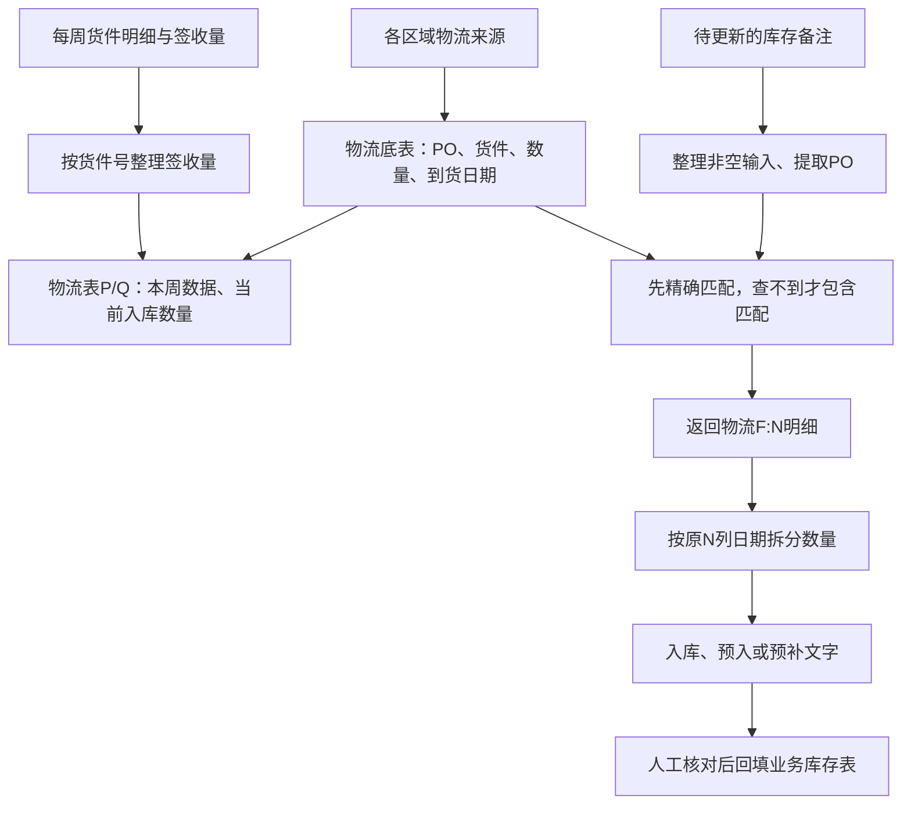

# 库存更新查询表－星火：工作逻辑与字段字典

> **一句话定位**：拿库存备注里的采购单号，查物流明细，按到货日期拆成“入库／预入／预补”，生成供人工核对和复制的文字。
> **版本与状态**：v1，2026-11-16，unreviewed（已核查文件，待业务确认）。
> **依据**：[[原件存档/库存更新查询表-星火_v1_20261116.xlsx]]。以下为导出文件的公式与保存值核查，未联网刷新、未验证在线脚本，也未修改源表。不要把保存结果当成实时结果。

## 按问题查字典

| 你要解决的问题 | 去哪里看 |
|---|---|
| 第一次接手，想知道整张表怎么跑 | 第1节总览 → 第2节按数据流读一遍 |
| 某一列从哪来、有什么用 | 第3节字段字典 |
| 为什么预入36会查出入库164 | 第4节完整例子 |
| 查到了但不敢复制，先核对什么 | 第5节使用顺序与异常处理 |
| 要调整公式或交接维护 | 第6节公式索引与边界、第7节待确认 |

**阅读约定**：列字母只属于所在小节的工作表；“公式事实”描述文件现状，“业务解释”帮助理解，“建议”不代表表格已经具备该功能。所有数量先按源表原单位理解，文件表头未明确件／箱，不擅自换算。

## 1．总览：先认清三层数据

| 层次 | 工作表 | 负责什么 |
|---|---|---|
| 来源与整理 | FBA库存数据(每周更新) | 从货件明细整理货件号，汇总签收量 |
| 物流底表 | 物流数据-美／欧／亚／大洋／海外仓 | 保存PO对应的货件、数量、仓库、预计入仓和到货日期；部分表另算本周到货提示和签收数量 |
| 查询与输出 | 查询(柳思）、查询(伟卿）、查询(欣桐）、查询(雯婧）、查询(子萌） | 按输入备注提取PO、查物流、生成更新文字 |
| 备份 | 查询(郑晴)-备份、查询(备份)、物流数据-备份 | 隐藏备份页；物流备份页主要是备份表链接，不能视为另一个有效数据池 |

共14张表，其中大洋、海外仓和3张备份页隐藏。**隐藏不等于停用**：查询公式仍把大洋、海外仓纳入合并范围。

### 数据流全图

**最容易误读的一点：P/Q这条辅助链没有接入查询页。** 查询返回的是物流F:N，状态判断用原N列到货日期，不用P列“本周数据”，也不用Q列“当前入库数量”。人工是否把辅助结果回填到N列，需要确认；文件没有证明这一步自动完成。

本表也没有用销量、出库、退货等计算库存余额。这里的“入库”是更新备注的状态文字，不能直接当成当前可售库存。

## 2．按数据流程，走一遍工作逻辑

### 第一步：准备物流记录——先知道“哪张PO发了哪些货”

美、欧、亚、大洋四张物流表的主要结构一致：F列PO → G列货件号 → J列SKU → K列数量 → M列预计入仓 → N列到货日期。

文件中保留了从外部Google表格抓物流数据的表达式：亚洲、大洋的D2内有跨表导入与查询；美、欧的A1则是**没有等号的公式文字**，不能仅凭这段文字就断言该表正在自动抓数。美、欧D2起有保存数据，但其最新刷新动作不能由这些静态内容确认。

海外仓列位不同：E列才是PO，F列已是货件号。后面的统一查询没有替它调整列位，这是当前结构问题，不是另一套正确匹配规则。

**本步产出**：一张PO可以对应多条货件记录；每条记录保留数量、SKU、仓库和日期。查询公式不会自动去重。

### 第二步：整理每周签收——知道“货件签收了多少”

在“FBA库存数据(每周更新)”中：

1. F:P放货件明细，其中F为货件单号，P为签收量。
2. D列把空白货件号向下补齐：该行F为空，就沿用上方最近的非空货件号。
3. A列用`UNIQUE(D:D)`列出不重复货件号。
4. B列用`SUMIF`汇总签收量。原式为`SUMIF(D:P,A1:A17965,P:P)`；条件范围写成了多列D:P，不能无条件当作标准的D列对P列汇总，需在原运行环境复核。

**业务解释**：这一层按货件号整理签收，不是按“货件号＋SKU”拆签收。一票货件有多个SKU或被拆到多个PO时，不能把货件总签收量直接当成每一条PO/SKU的入库量。

### 第三步：物流底表生成辅助判断——但尚未自动改变查询结果

美／欧／亚／大洋的P、Q列执行以下分支：

| 条件 | P列“本周数据” | Q列“当前入库数量” |
|---|---|---|
| 原N列有到货日期 | 沿用N列日期 | 直接使用本条K列全部数量 |
| N为空，货件查到签收量且大于0 | 填`TODAY()`，即查询当天 | 返回匹配到的货件签收量 |
| N为空，签收量为0 | P不填到货日期 | 匹配成功时可返回0 |
| N为空，匹配失败 | 通常被错误处理转为空白 | 通常被错误处理转为空白 |

美表P支持FBA和STAR编号；欧／亚／大洋P只提取FBA编号，而Q支持FBA和STAR，口径不完全一致。

**这里的今天是“根据签收量推定的日期”，不是还原出的实际到货日期。** 只签收一部分也会触发P填今天。若把这个日期回填N，Q又会改取整条K数量，所以部分签收如何处理必须有明确规则。

部分物流表还做了待跟进标记：欧／亚／大洋在未到货、预计入仓已进入未来14天窗口时标“是”；没有预计日期时，欧表看周数日期是否早于今天30天，亚／大洋看20天。它是跟进提示，不是入库确认。

### 第四步：把库存备注放入查询页——保留原文，另提取PO

五张可见人员页采用同样的核心布局：A列放待查内容，B3起将A列非空内容排紧。它不去重，也不自动校验格式。

页面有6组查询块：C1、C9、C17、C25、C33、C41依次引用B3:B8。**输入列表可以更长，但现有6组不会自动处理第7条及以后。**

以第一组为例：

- C1保留原文，例如`预入36，PO260617104-3，8.3截单`。
- D2通过文字规则删掉数量前缀和备注，得到`PO260617104-3`。
- C2另从原文抓第一段数字用于比较数量。因此直接输入纯PO虽然可能查得到，却可能把PO里的数字误当数量。

### 第五步：查PO——先完全相同，再退回包含匹配

F2把五个区域物流表A:O上下拼接，在第6列（F列）找D2的PO：

1. 完全匹配找到记录：返回所有完全匹配的记录。
2. 完全匹配返回无结果：再找“包含这个PO文本”的记录。
3. 第二次也找不到：不代表数量为0，应视为未匹配，回查PO与来源。

返回第6～14列，即采购单号、FBA编号、国家、店铺、SKU、数量、仓库、预计入仓、到货日期。**不额外按SKU、国家、店铺过滤，不去重，不以签收量替换数量。**

包含匹配存在串单风险：例如`PO…-1`可能带出`PO…-10`。而完全匹配一旦有结果，就不会再补收那些只包含PO的记录。复制前必须核对返回的PO和SKU。

### 第六步：按日期拆状态——计算的是物流整条数量

第一组汇总范围固定为K2:K6、N2:N6，基准日期B2=`TODAY()`：

| 输出 | 实际计算 | 业务上怎么读 |
|---|---|---|
| C2 数量差 | `SUM(K2:K6)－原文第一段数字`；相等时设计为空白 | 查询总量和原文字数量的差，不是自动判定缺货 |
| C3 以前到货 | N日期小于今天的K数量合计 | 按表内日期被归到以前到货的数量 |
| C4 今天到货 | N日期等于今天的K数量合计 | 按表内日期被归到今天到货的数量 |
| C5 剩余预入 | 总数量－C3对应数量－C4对应数量 | 没有被前两类扣掉的数量，不是独立签收核算 |

C3/C4通常写“入库”；如果首条G2包含STAR，整组合计改写“预补”。C5写“预入”。首条判断不能正确代表一组混合FBA／STAR货件的逐条类型。

**日期注意**：公式没有显式加入“N非空”条件，也没有在这一步清洗文本日期、带时间日期。当前示例的空日期留在预入，但其他异常日期在原环境如何判定仍要实测，不能把所有非标准日期都视为已正确处理。

### 第七步：生成可复制文字——最后仍需业务核对

- C3:C5提供按状态合计的文字。
- P/Q提供每条明细的两套文字：“入库××”“预入××”。它们只根据数量拼字，**不是系统替你选好的状态**。
- T/U筛出N为空且G完全符合`FBA＋大写字母或数字`格式的货件，列出货件号与预计入仓；S列拼成“催派”文字。
- 带换行、尾部备注或STAR的编号不会通过这条严格FBA筛选。未填预计日期的催派文字也应先补核日期。

**建议的业务落点**：核对后再回填对应库存表。既有培训页要求按上一周、以周日为节点处理入库；本表却按今天拆分，二者不是同一个时间口径。不能看到“今天入库”就默认粘到今天那格。此处参考的是未经人工审核的培训记录，并非本表公式已经落实的规则。

## 3．字段字典：按来源 → 中间处理 → 输出查

### 3.1 每周FBA货件明细

以下列属于“FBA库存数据(每周更新)”。明细来源系统、提取截止时间和数量单位未在公式中完整说明。

| 列 | 字段 | 来源／处理 | 用途与边界 |
|---|---|---|---|
| F | 货件单号 | 原始明细 | 签收归集的识别号；空行号由D辅助补齐 |
| G | 店铺 | 原始明细 | 核对账号归属；当前签收汇总未用它作条件 |
| H | 国家 | 原始明细 | 核对站点；未参与汇总条件 |
| I | 货件状态 | 原始明细 | 供阅读，当前B汇总并不按状态筛选 |
| J | 创建时间 | 原始明细 | 货件创建日期时间 |
| K | 到货时间 | 原始明细 | 原始到货信息；物流P填今天时并未引用本列 |
| L | 实际发货时间 | 原始明细 | 发运时间，不等于签收时间 |
| M | MSKU | 原始明细中的卖家SKU | 当前汇总未按MSKU细分 |
| N | 申报量 | 原始明细 | 建单申报数量，不是签收量 |
| O | 已发货 | 原始明细 | 已发数量，不是可售库存 |
| P | 签收量 | 原始明细 | B列汇总所用数量 |
| D | 补齐货件号 | F非空取F，否则找上方最近非空F | 让续行数量归到同一货件；首条缺号时应查源数据 |
| A | 不重复货件号 | D列去重 | 给物流表匹配用；标题与空值也要留意 |
| B | 货件签收汇总 | 原式`SUMIF(D:P,A1:A17965,P:P)` | 条件区域为多列，需确认；并非PO/SKU级签收 |
| C、E | 间隔列 | 未识别为主要业务字段 | 不承担已核查的主链计算 |

### 3.2 常规物流底表：美、欧、亚、大洋

| 列 | 字段 | 来源／计算 | 对查询的作用 |
|---|---|---|---|
| A:C | 辅助区 | 各表不同；美／欧C1保存日期参数，A含查询表达式文字；美B有组合键 | 不是统一业务结构，不要整块当作无用列删除 |
| D | 周数 | 保存为日期；来源物流周节点 | 跟进判断会用到；不是实际到货日 |
| E | 序号 | 物流记录标识；亚表E1未填标题 | 可用于追踪原记录；查询页不返回本列 |
| F | 采购单号 | 物流记录PO | 查询的主匹配字段 |
| G | FBA编号 | 货件标识，实际也可能含STAR或备注 | 签收匹配、STAR判断和催派筛选 |
| H | 国家 | 物流记录 | 返回展示，不是查询条件 |
| I | 店铺 | 物流记录 | 返回展示，不是查询条件 |
| J | SKU | 物流记录 | 返回展示；用于人工核对是否串单 |
| K | 数量 | 本条物流数量 | 查询页按它汇总，不是自动取实际签收 |
| L | 仓库 | 物流记录 | 目的仓／转仓文字 |
| M | 预计入仓时间 | 物流记录 | 跟进与催派参考，不参与前台已入库判断 |
| N | 到货日期／到货查询日期 | 文件保存日期，部分区域导入涉及此列 | 前台状态判断的实际依据；名称不同不能自行认定业务含义完全一致 |
| O1 | 跟进窗口上限 | `TODAY()+14` | 未来14天界限 |
| O2起 | 待跟进标记 | 欧／亚／大洋有数组判断；美O2未见对应公式 | “是”表示需跟进，不是已到货 |
| P | 本周数据 | N优先，否则签收量大于0填今天 | 没有自动接入前台 |
| Q | 当前入库数量 | N非空取K，否则查货件签收量 | 没有自动接入前台；有日期即取全量 |

### 3.3 海外仓：必须单独看列位

| 列 | 实际字段 | 与常规物流表的区别 |
|---|---|---|
| D | 周数 | 相同 |
| E | 采购单号 | 常规在F，此处提前一列 |
| F | FBA编号 | 常规在G；统一查询却把此列当PO |
| G／H／I | 国家／店铺／SKU | 各提前一列 |
| J／K | 数量／仓库 | 各提前一列 |
| L／M | 预计入仓时间／到货查询日期 | 各提前一列 |
| N1／N2起 | 今天+14／待跟进标记 | 不是常规N列到货日期 |

海外仓导入公式还读取C1作为日期筛选，但当前C1为空，D2保存`#REF!`。需先恢复数据源和筛选日期，再统一字段，不能仅修前台显示。

### 3.4 人员查询页：以第一组为例

| 位置 | 字段／作用 | 来源与解释 |
|---|---|---|
| A列 | 原始待查备注 | 输入区；格式会影响PO和数量提取 |
| B2 | 当前日期 | `TODAY()`，所有查询组共用 |
| B3起 | 整理后的备注 | A列非空内容；不去重 |
| C1 | 本组原文 | 引用B3；后续组每8行递增 |
| C2 | 数量差 | 查询5行数量合计减原文字首段数字 |
| C3／C4／C5 | 以前入库／今天入库／剩余预入 | 根据本组K、N计算并拼接原备注 |
| D2 | 清洗后的PO | 去掉数量前缀及部分尾部备注 |
| E2起 | 查询序号 | 有输入时编号；不是匹配准确性的校验 |
| F:N | 匹配明细 | F采购单号、G货件、H国家、I店铺、J SKU、K数量、L仓库、M预计日期、N到货日期 |
| P2:P7 | 逐条入库文字 | 本条K数量加“入库”；不按N筛选 |
| Q2:Q7 | 逐条预入文字 | 本条K数量加“预入”；不按N筛选 |
| S列 | 催派文字 | 货件号加预计入仓时间 |
| T/U列 | 待催派货件／预计日期 | 从G:N筛N空白且G为纯FBA号的记录 |
| O、R列 | 分隔区 | 本次未识别为主计算字段 |

下一组参考：原文C9、PO D10、查询F10、汇总数量K10:K14；依此每组下移8行。页内查6条备注与每条只汇总5条明细，是两个不同限制。

## 4．完整例子：预入36为什么会查到入库164

来源：“查询(柳思）”C1:N6的保存值，不代表此刻实时库存。

输入：`预入36，PO260617104-3，8.3截单`。

| 查询行 | 货件号 | 数量 | 保存的到货日期 | 归类 |
|---|---|---:|---|---|
| 2 | FBA19JR8KW6S | 60 | 2026-10-12 | 以前到货 |
| 3 | FBA19JR6F29Q | 36 | 空白 | 剩余预入 |
| 4 | FBA19JR8DKT0 | 36 | 2026-09-28 | 以前到货 |
| 5 | FBA19JR6KVRN | 40 | 2026-09-14 | 以前到货 |
| 6 | FBA19JR4CL27 | 28 | 2026-09-20 | 以前到货 |

计算路径：

1. D2提取PO；F2查到5条记录。
2. 总量 = 60＋36＋36＋40＋28 = **200**。
3. 以前到货 = 60＋36＋40＋28 = **164**；当天到货 = **0**。
4. 剩余预入 = 200－164－0 = **36**。
5. C3生成`入库164，PO260617104-3，8.3截单`；C5生成`预入36，PO260617104-3，8.3截单`。
6. C2差额 = 200－输入的36 = **164**。

**怎么使用这个结果**：先确认164是否早已写过入库，再决定如何更新；不能因为本次又查出164，就再新增164。查询展示历史记录，没有自动判断业务库存表是否已经登记过。

## 5．使用顺序与异常处理

以下是根据现有公式提出的操作建议，不是已经验证的自动化流程。

1. **先看来源是否有效**：日期范围是否正确，导入位置是否报错，每周签收明细何时更新。
2. **每批先放不超过6条备注**：保留数量和完整PO，避免仅填纯PO造成差额误读。
3. **核对返回明细**：PO是否完全一致、SKU是否正确、是否跨店铺；包含匹配结果逐条确认。
4. **数清明细行**：超过5条时，停止直接使用本组合计，先独立核全量。
5. **查部分签收与STAR**：不要仅凭一个到货日期就把整票判完；混合类型逐条核对。
6. **最后复制**：核实历史入库是否已登记、业务归属周是否正确，再选用合计或逐条文字。

| 看到什么 | 先查什么 | 不要直接怎么做 |
|---|---|---|
| 查不到PO | D列清洗结果、原PO格式、区域源表、导入错误 | 不要当作没有在途或数量为0 |
| 数量差很大 | 原文第一段数字是否其实是PO号 | 不要直接认定缺货 |
| 明细合计和输出对不上 | 是否超过5条、有重复、字段错列 | 不要只改合计数字掩盖原因 |
| FBA已签收但仍显示预入 | 物流P/Q是否更新、N是否仍空白 | 不要以为每周数据会自动更新前台 |
| 催派列表缺票 | 编号是否带备注／换行、是否STAR | 不要认定无催派需求 |
| 修改输入却结果不变 | 是否在使用这个导出的Excel文件 | 不要相信固定兜底显示的旧值 |

## 6．维护时要知道的公式索引与边界

### 关键位置索引

| 要追查的逻辑 | owning位置（实际负责计算的单元格） |
|---|---|
| 输入去空行 | 人员页B3：`QUERY(A:A,"select A WHERE A is not null")` |
| PO文字清洗 | 人员页D2及各组对应行：多层`REGEXREPLACE` |
| 精确／包含两段匹配 | 人员页F2及各组对应行：`IFNA(精确QUERY,包含QUERY)` |
| 数量比较 | 人员页C2：`REGEXEXTRACT(C1,"\d+")`与`SUM(K2:K6)` |
| 按到货日期拆分 | 人员页C3:C5：`SUMIFS`、剩余差额、`REGEXMATCH(G2,"STAR")` |
| 签收归集 | FBA页D1、A1、B1：补齐号、去重、SUMIF |
| 签收匹配与推定日期 | 常规物流表P1/Q1：提取货件号后`VLOOKUP`精确查A:B |
| 催派筛选 | 人员页T2：N空白且G匹配`^FBA[0-9A-Z]+$` |

表中表达式是便于读懂的摘录，完整原式以归档工作簿为准。

### 已确认的结构风险

| 优先级 | 事实 | 影响／建议 |
|---|---|---|
| 先处理 | 大量在线函数封装为`IFERROR(__xludf.DUMMYFUNCTION(...),固定值)` | 导出Excel可能继续显示旧值；需回原在线环境验证刷新，不能以本地显示正常作为通过 |
| 先处理 | 前台只读物流F:N，P/Q未接入 | 明确人工回填环节或重新设计连接，别称其全自动 |
| 先处理 | 海外仓PO在E，统一查询却查F | 先统一列位；大洋、海外仓D2已有保存的`#REF!`也应处理 |
| 先处理 | 汇总K2:K6只有5行，逐条输出却到第7行 | 第6条可能被漏算；更多记录还可能与后续块冲突，具体溢出需在线实测 |
| 核对后用 | 只按PO，不按SKU／店铺，包含匹配不去重 | 串单和重复记录都会影响数量 |
| 核对后用 | STAR判断只读首条G2 | 混合货件需逐条分类型 |
| 核对后用 | N有日期即按整条K数量计算 | 缺少部分签收的分摊规则 |
| 需复核 | FBA B1条件范围D:P与求和范围P:P不对称 | 在原环境用小样本验证，不把意图写成已验证计算 |

### 来源与验证记录

- 原文件：`C:\Users\HDKJ\Downloads\库存更新查询表-星火.xlsx`。
- 归档版本：`原件存档/库存更新查询表-星火_v1_20261116.xlsx`，与原文件SHA-256一致：`96A4B552051B940FC8300B168419A0CCE2984AB2EEEFB43F55D72F740899C4ED`。
- 已检查：14张表的结构、主要公式与引用、5张人员页的6个查询块入口、物流与FBA辅助链、示例5条记录的数量对账。
- 未检查：外部在线源表当前状态、在线公式实际重算、Google脚本、人工回填动作、件箱换算与业务归属周审批。
- 更新约定：源表结构或规则变更时，新增原件版本；同步更新本页来源、字段映射、示例和问题状态，不覆盖历史原件。本文为知识查阅页，不复制一份平行字典到其他目录。

## 7．待业务确认

- [ ] K数量、FBA签收量和库存备注数字是否同一单位？是否存在件／箱混用？
- [ ] 物流N究竟记录实际到货日、查询确认日还是人工归属周？不同区域是否一致？
- [ ] P/Q由谁核对，是否人工回填N；部分签收按什么规则拆到PO和SKU？
- [ ] 预补在本业务中的落账口径，以及STAR与AWD的对应关系，是否有书面规则？
- [ ] 前台“今天”与库存表“上一周”如何衔接？历史已登记入库怎样避免重复？
- [ ] 原在线表是否还有导出文件中看不到的脚本或按钮在完成这些动作？

## 相关页面

- [[wiki/HOTOR业务/入职培训/日常工作流程拆分详解/下单盘点工具表字段字典]] — 后续下单盘点工具的计算口径；不等于已证实本表自动连接它。
- [[wiki/HOTOR业务/入职培训/日常工作流程拆分详解/工具表、脚本使用说明-2026-11-03]] — 库存更新归属周、删除／粘贴脚本的培训记录（unreviewed）。
- [[wiki/HOTOR业务/入职培训/入职培训索引]] — 返回实操资料入口。
