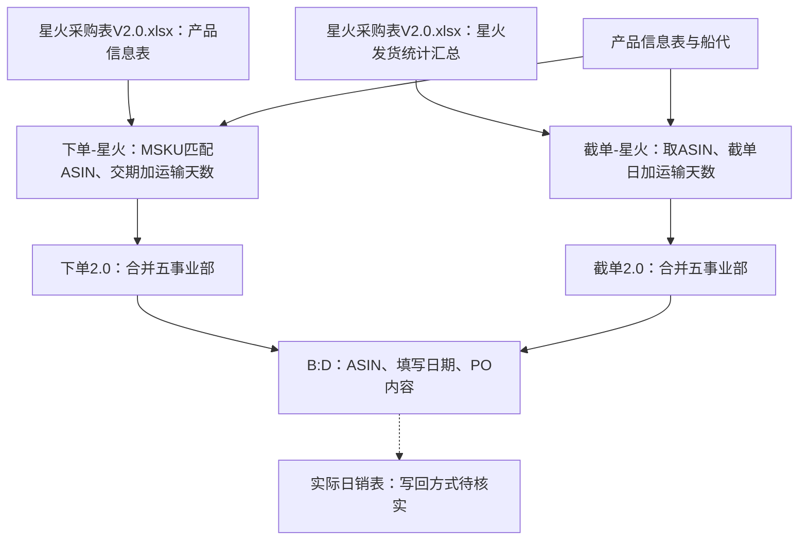

# 日销表数据修改.xlsx：字段字典与填写逻辑

> **一句话定位**：把采购与截单记录整理成“哪个ASIN、填在哪天、填哪段PO备注”。它不生成PO子单，也不是存放全部实际日销和可售库存的那张表。
> **状态**：unreviewed；核查日期2026-11-16。仅依据静态公式与保存结果，未执行在线刷新或写回脚本。
> **来源**：[[raw/知识文件归档/运营中心知识库/计划运营SOP课程存档/日销表数据修改-公式与样例核查-20261116-codex]]、[[日销表数据修改_v1_20261116.xlsx]]。

## 按问题查

| 要查的问题 | 阅读位置 |
|---|---|
| PO和数量从哪里来 | 第2节两个输入分支 |
| SKU为什么变成ASIN | 第3节F/B与产品信息表 |
| 日期为什么比预计日晚一天 | 第2节日期排布规则 |
| 该复制哪几列 | 第3节最终输出B:D；是否由脚本搬运待确认 |
| 待生产与截单能不能直接相减 | 第4节同SKU两笔PO例子 |
| 抓数失败应该检查什么 | 第5节异常处理 |

## 1．总览：两条支线汇成两份填写清单

| 子表原名                    | 负责什么                       |
| ----------------------- | -------------------------- |
| 下单-星火／无双／理想／日亿／长风       | 各事业部采购记录→待生产填写内容           |
| 截单-星火／无双／理想／日亿／长风       | 各事业部发货统计→截单填写内容            |
| 下单2.0                   | 合并五个事业部下单结果，只保留PO内容非空行     |
| 截单2.0                   | 合并五个事业部截单结果，只保留PO内容非空行     |
| 产品信息表                   | 整理各事业部MSKU→ASIN等商品映射       |
| 船代                      | 国家、发货方式与运输天数参数             |
| 查询已发货PO、查询未发货PO         | 单笔PO查询与填写文字辅助              |
| 下单1.0、截单1.0-星火、截单1.0-无双 | 旧版处理页，保留供追溯；不混作2.0的同一套字段位置 |

共19张子表。以下按星火分支解释并定位，其他事业部的外链、起始行、数组末行可能不同，不能直接复制星火范围当作所有分支的统一契约。

## 2．按数据流逐步看



### 下单分支：采购记录 → 待生产备注

1. “下单-星火”H2读取《星火采购表V2.0.xlsx》对应在线“产品信息表”A:AF，选择第1/23/7/31/18/20列，放到H:M。筛上游第6列创建日期≥A2且PO非空。
2. F优先取I下单MSKU；I空才用E补充。B按F在本文件“产品信息表”A:D精确查ASIN。
3. G以K交期为起点，加MSKU前两位国家代码对应的运输天数。只按国家匹配，取首条，不区分发货方式。
4. D拼接：`预入数量，最终PO子单，交期MM.DD，待生产`。
5. C在G基础上按同ASIN、同基础日期的出现顺序依次增加0、1、2……天。
6. “下单2.0”B2合并五个“下单-”页B2:O2999，筛合并后第3列（原D列）非空；没有ASIN完整性条件，也没有自动去重。

A2保存2026-11-09；标题“创建时间（上周二）”并不会让日期自动变成上周二。公式依据的是单元格实际值。

### 截单分支：发货安排 → 截单备注

1. “截单-星火”F2读取《星火采购表V2.0.xlsx》对应“星火发货统计汇总”C:S，以截单日≥A2且日期非空筛选，返回PO、截单日、MSKU、方式、品名、数量、店铺、ASIN。
2. B直接取M的ASIN，不重复用产品信息表查一次。
3. E用MSKU前两位国家代码＋I发货方式匹配“船代”B/C，取D天数加到G截单日期。
4. D拼接`预入数量，PO，M.D截单`；I恰好为“第三方-AWD”时增加AWD文字。
5. C按同ASIN同基础日期错开重复记录，与下单分支类似。
6. “截单2.0”合并五个“截单-”页B2:N2980，同样只要求原D备注非空。

当前A2为2026-11-30，是筛选下限，没有设上限；不是只取一天，也不是只取已经实际发走的订单。

### 填写日期不等于实际到货日期

两个分支共同规则可写成：

```text
填写日期 = 基础预计日期
         + 截至本行，同ASIN且同基础预计日期的记录数
         - 1
```

第二条同组记录会被放到次日，第三条再加一天。**这是公式对填写位置的排布，不是物流日期确认，也不是PO拆单。** “为避免同一格冲突”是可能的业务目的，未经脚本或人员确认，不作为既定事实。

## 3．字段字典

### 3.1 “下单-星火”

| 列 | 原字段名 | 来源／处理 | 注意事项 |
|---|---|---|---|
| A2 | 创建时间（上周二） | 上游创建日期筛选下限 | 看实际日期值，不看标题猜周期 |
| B | 填写-ASIN | F→产品信息表A:D第4列 | 失败可变空，合并表不会因此自动拦截 |
| C | 填写-日期 | G加同ASIN同日期的累计序号减1 | 下游真正的填写日期 |
| D | 填写-PO内容 | H/J/K拼待生产文字 | 中文逗号分隔PO |
| E | 未匹配MSKU时 | I为空时的补充值 | 当前分支没有从产品SKU自动推断它的公式 |
| F | MSKU | I有值取I，否则E | 查ASIN、取国家码的实际输入 |
| G | 填写-日期2 | K＋国家运输天数 | 排布前基础日期 |
| H | 采购单最终编号 | 上游产品信息表A | 本表不重新编号 |
| I | 下单MSKU | 上游W | 采购记录给定的销售商品 |
| J | 发货数量 | 上游G | 下单链里是采购处理后的数量，不等于实际发货 |
| K | 预计到货时间 | 上游AE | 下游用作交期，加运输天数；须确认原业务含义 |
| L | SKU | 上游R | 产品SKU，不是ASIN |
| M | 分类 | 上游T | 品类信息 |
| N | 下单-预计到货 | 与G同类计算 | 辅助列，没有C的错日排布 |
| O | 下单-PO内容 | 类似D，但数量后的逗号是英文 | 不应无差别替代中文逗号的D列 |

星火主要数组覆盖至1221行，合并表却读取至2999行；后续新增行是否已生成前置公式，需要检查，不能只看汇总范围够大。

### 3.2 “截单-星火”

| 列 | 原字段名 | 来源／处理 |
|---|---|---|
| A2 | 截单时间 | 上游截单日期筛选下限 |
| B | 填写-ASIN | M直接引用 |
| C | 填写-日期 | E加重复排布偏移 |
| D | 填写-PO内容 | F/G/I/K拼接；第三方-AWD另标AWD |
| E | 基础日期（无标题） | 截单日＋国家与方式对应天数 |
| F | PO订单号 | 上游发货统计D |
| G | 截单时间 | 上游C |
| H | MSKU | 上游N |
| I | 发货方式选择 | 上游F |
| J | 发货产品名称 | 上游I |
| K | 发货数量 | 上游J |
| L | 发货店铺 | 上游M |
| M | ASIN | 上游S |
| N | 品类 | F的PO匹配上游产品信息表A:T，返回第20列 |

星火主要数组至2008行。E的运输参数查找失败时，原式用0天兜底，可能让预计日期直接等于截单日；这种结果要按匹配异常处理，不能当成零天运输。

### 3.3 “下单2.0”“截单2.0”：最终填写清单

两张表都是**B=填写-ASIN、C=填写-日期、D=填写-PO内容**。后面的列保留来源明细供核对，各自继承下单/截单字段布局。

它们上下拼接五个事业部的记录，不按ASIN合并数量，不生成PO，不证明目标日销表已经更新。后续怎样根据ASIN定位实际SKU子表、先删哪些旧备注、怎样防重复，需要核对写回脚本或实际操作。

### 3.4 “产品信息表”“船代”及单笔查询

| 子表／位置 | 字段与作用 |
|---|---|
| 产品信息表A:D | 汇总映射：MSKU、FNSKU、状态、ASIN |
| 产品信息表I:L／O:R／U:X／AA:AD／AG:AJ | 分别为无双、星火、理想、长风、日亿的映射区；A:D拼接符合字母开头的MSKU行 |
| 产品信息表状态列 | 在售/停售等随映射保存，但主合并条件未按状态排除停售；重复MSKU查找取首匹配 |
| 船代A:D | 国家中文名、国家代码、发货方式、运输天数；下单只查国家，截单查国家＋方式 |
| 查询已发货PO | B1备注→C1提取PO→查发货统计→预计日期与备注；名称不能替代实际发货状态验证 |
| 查询未发货PO | B1备注→C1提取PO→查采购明细→国家、交期、数量与待生产文字 |

“查询未发货PO”部分数组只有3:7行，备注式又引用到526行，范围不一致；单笔多明细时不能默认完整。“查询已发货PO”的预计日期用按国家首匹配的方式，与2.0截单分支按国家＋方式不同。旧版和辅助页不能当成2.0的完全等价替代。

## 4．一个真实商品的两条分支

商品：产品SKU **KTHDCH006-NA-L-ML2**，销售MSKU **CABJT.KTHDCH006-NA-L-ML2**，ASIN **B0DZX9FXGL**。映射见本文件“产品信息表”A6599:D6599，星火原始区O3343:R3343也有该记录。

| 分支及行号 | PO | 数量 | 起始日期 | 参数 | 基础及填写日期 |
|---|---|---:|---|---|---|
| 下单-星火465→下单2.0的465 | PO261112357-1 | 1000 | 交期2027-01-04 | CA首条55天 | 2027-02-28 |
| 截单-星火8→截单2.0的7 | PO261015069-1 | 504 | 截单2026-11-30 | CA＋一拆五/普通55天 | 2027-01-24 |

对应输出文字：

```text
预入1000，PO261112357-1，交期01.04，待生产
预入504，PO261015069-1，11.30截单
```

**1000和504属于两个不同PO，不能用1000−504得出剩余待生产496。**同SKU只说明商品相同，不能代替订单关联。两条日期计算与文件保存值一致，并不证明实际日销表已经写入。

## 5．操作顺序与异常处理

1. 先核对各事业部A2筛选日期和源表刷新状态，再看有没有漏单。
2. 核对最终输出B是否有ASIN、C是否为合理日期、D是否保留正确PO；D有内容并不保证其他字段有效。
3. 看MSKU国家码、运输方式是否匹配“船代”，特别是查找失败被0天掩盖的情况。
4. 同商品多批订单按PO分别核对，不将两个分支全部相加或相减当库存余额。
5. 确认写回机制后使用B:D，核对目标业务周、历史备注及重复写入；不要把辅助O列直接替换D列。

| 异常 | 首先检查 |
|---|---|
| ASIN空白 | I/E/F的MSKU和产品信息表是否存在映射 |
| 预计日期等于截单日 | 国家＋方式查找是否失败后用了0天 |
| 填写日比基础日迟1天 | 是否同ASIN同基础日的第二条，不先认定船期错误 |
| 查得到PO但没进汇总 | 备注是否为空、源数组是否到末行、合并范围是否覆盖 |
| 数量看似重复 | 是否同SKU不同PO、是否上下游旧备注未删除 |
| Excel里改了输入结果不变 | 在线函数封装成DUMMYFUNCTION与固定兜底值，不是有效刷新 |

## 6．关联与待确认

- [[星火采购表V2.0字段字典]] — 真实PO子单和数量从这里产生。
- [[库存更新查询表-星火字段字典]] — 用备注中的PO查物流；不是直接把本文件当物流来源。
- [[wiki/HOTOR业务/入职培训/计划岗数据表合集/下单盘点工具表字段字典]] — 从实际日销表读取备注，进入后续盘点。
- [[采购、日销、库存查询与下单盘点数据流转说明]] — 四表关联入口。

- [ ] 写回实际日销表的脚本在哪里，ASIN如何定位SKU子表？
- [ ] 重复记录错开日期是否是预期业务规则？跨月、跨周如何处理？
- [ ] 运输参数由谁维护；下单按国家取首条是否符合业务默认方式？
- [ ] 各事业部固定抓取范围与公式末行如何扩展，重复MSKU如何治理？
