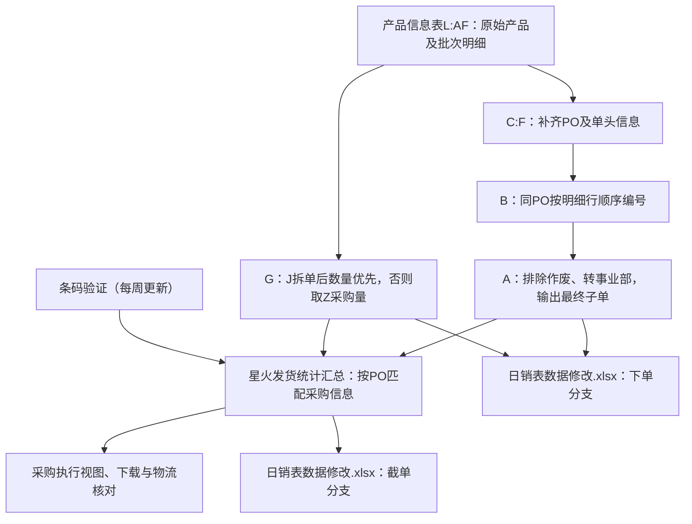

# 星火采购表V2.0.xlsx：字段字典与PO拆单逻辑

> **先记住**：原始采购明细已经按产品/批次分行。本表补齐所属PO，再给同一PO的明细按行顺序编子单号；不是按SKU去重编号，也不是自动决定拆单数量。
> **状态**：unreviewed；核查日期2026-11-16。以下依据导出文件的公式与保存值，未在线刷新，原件未改。
> **来源**：[[raw/知识文件归档/运营中心知识库/计划运营SOP课程存档/星火采购表V2.0-公式与样例核查-20261116-codex]]、[[星火采购表V2.0_v1_20261116.xlsx]]。

## 按问题查

| 你要查什么 | 位置 |
|---|---|
| PO的-1、-2在哪里产生 | 第2节步骤2、步骤3 |
| 同SKU为什么有好几个子单 | 第4节黑色手套例子 |
| 发货数量为什么不是原采购量 | 第3节G/J/Z字段 |
| 从PO怎样找到SKU、标签、店铺 | 第3节两张核心表 |
| 这些数据流到哪里 | 第5节跨表接口 |
| 作废、排序会不会影响编号 | 第6节异常处理 |

## 1．总览：哪些子表负责主流程

| 子表原名                         | 作用                            | 阅读优先级     |
| ---------------------------- | ----------------------------- | --------- |
| 产品信息表                        | 原始采购明细、PO子单编号、数量覆盖、发货日期回查     | 先读        |
| 星火发货统计汇总                     | 以子单号和标签条码整理截单/发货安排，核对商品       | 先读        |
| 条码验证（每周更新）                   | FNSKU、MSKU、ASIN、产品SKU、店铺的对应关系 | 查错货时读     |
| 条码验证-谷                       | 另一份条码与商品对应资料，结构与主条码表不同        | 按涉及业务查阅   |
| 未发货订单统计、查询(SKU)              | 从采购明细筛选待跟进订单或按SKU找记录          | 查订单时读     |
| 常备库存                         | 筛选产品备注含“常备”的记录                | 按需        |
| 采购-仙／罗／秋／康／雪／闽、采购-截图         | 按截单日、供应商等整理采购执行视图             | 发给采购前核对   |
| 下载-发货、星火采购数据汇总               | 按日期范围准备对外交接字段                 | 导出前核对     |
| JOB ID汇总、JOB ID回传、透明计划（每周更新） | 透明计划任务与商品状态关联                 | 标签业务辅助    |
| 大件体积                         | 按商品数量、装箱与尺寸估算体积               | 库容辅助      |
| 供应链数据汇总                      | 抓区域物流记录，供发货记录交叉检查             | 物流核对辅助    |
| 产品信息表-历史、星火发货统计-历史           | 历史数据，均隐藏                      | 不当作当前主表替代 |

全工作簿23张子表。本字典重点覆盖采购编号、SKU对应、数量、发货与下游交接；辅助表说明其作用，不代表所有标签、体积、历史逻辑均已重算验证。

## 2．按数据流读一遍



### 步骤1：原始数据先有明细行

“产品信息表”L:AF保存原始采购单号、品名、SKU、销售商品标识、数量、交期。L列常只在一张采购单第一行填PO，后续产品行留空。Q品名、R产品SKU、W销售MSKU在文件里是数据值，没有把一个单元格SKU拆成多行的公式。进入表之前如何导出或插入明细，需确认实际操作。

### 步骤2：把采购单信息向下补齐

C列先检查Q：没有品名就不输出PO。有品名时，L非空取本行L；L为空则找上方最近的非空L。D/E/F用同样思路承接供应商、采购员、创建时间。

因此每条SKU明细都有所属采购单。此处依靠行位置承接，不能随意把产品行挪到另一张采购单下面。

### 步骤3：给明细行编号

B1的数组公式判断整个C列同PO出现次数。只有一行，保留原PO；有多行，拼接“原PO-当前累计出现次序”。计数条件只有PO和行号，没有SKU、交期、店铺，也没有先排除作废行。

```text
若C为空：不输出
若COUNTIF(C列,本行PO)=1：输出本行PO
否则：输出本行PO + "-" + 从上到本行的同PO记录数
```

A列再根据I异动情况过滤：作废或转事业部→空白，否则取B。**B是自动编号，A才是下游读取的最终编号。** 原始L本身可能已有后缀；公式不会先把它还原为主单。

### 步骤4：决定每行实际使用多少数量

G的优先级：I作废→空白；J有值→J；否则→Z。J是拆单调整入口，可以是手填数量，也可以是局部算式。未发现统一比例自动拆量的主公式，也未发现这条G公式自动验证拆后总量等于原采购总量。

“转事业部”会清空A，但G只特别处理“作废”。所以不能仅按G有数就认定这是本事业部的有效订单。

### 步骤5：子单与发货记录关联

“星火发货统计汇总”D为PO子单号。G2的查找按D匹配“产品信息表”A，带出AE交期、E采购员、Q品名、G数量、AC产品备注；R另取供应商。

E为FNSKU，即商品标签条码。L:N、S等再从“条码验证（每周更新）”获取国家、店铺、MSKU、ASIN，并通过品名与MSKU比较提示“OK／填写有误”。这些校验检查对应关系，不证明实际已经发货或入库。

“产品信息表”H又按最终PO从“星火发货统计汇总”C回查截单日期，作为表内“发货日期”。它取首次匹配，不能当成多次发运完整履历。

## 3．字段字典

### 3.1 “产品信息表”：整理与调整区A:K

| 列 | 原字段名 | 来源／规则 | 对使用者的影响 |
|---|---|---|---|
| A | 采购单最终编号 | B经过I作废/转事业部过滤 | 下游引用的PO子单号 |
| B | 采购单自动编号 | C同PO按行次序编号 | 行序变化可能改变子单后缀 |
| C | 采购单号 | L向下补齐，Q为空不输出 | 原始PO归属 |
| D | 供应商 | M向下补齐 | 供应商归属 |
| E | 采购员 | N向下补齐 | 采购执行归属 |
| F | 创建时间 | O向下补齐 | 下游按创建时间筛采购批次 |
| G | 发货数量 | 作废空白；J优先，否则Z | 下游下单/发货所取数量；不等于已实际发出 |
| H | 发货日期 | 以A查发货统计D，返回C的首次匹配 | 实质来自截单日期，不是独立物流离厂确认 |
| I | 异动情况 | 数据记录，如导入、新增、作废、转事业部 | 影响有效编号和数量 |
| J | 拆单后数量 | 调整值或局部计算 | 覆盖原Z数量；零值不应当作空白 |
| K | 对应箱数 | J/X，保留1位小数 | 是拆单数量对应箱数，不是自动整箱向上取整 |

### 3.2 “产品信息表”：原始区L:AF

| 列 | 原字段名 | 含义与边界 |
|---|---|---|
| L | 采购单号 | 原始PO；可能只在首行填，也可能已经含后缀 |
| M／N／O | 供应商／采购员／创建时间 | 单头信息，后续由D/E/F补齐 |
| P | 产品维度 | 原始资料的记录维度标记 |
| Q | 品名 | 产品描述，也是C:F是否输出的判断条件 |
| R | SKU | 产品SKU，原始明细已提供 |
| S／T | 品牌／分类 | 品牌与品类归属 |
| U | 店铺 | 该采购明细的店铺 |
| V | FNSKU | 销售标签条码，不是FBA货件号 |
| W | MSKU | 店铺中的销售SKU；《日销表数据修改.xlsx》用它查ASIN |
| X | 单箱数量 | 每箱装量；用于K拆单箱数 |
| Y | 箱数 | 原始箱数，不代表已由当前Z重新校验 |
| Z | 采购量 | 原始明细数量；无J覆盖时进入G |
| AA／AB | 含税单价／价税合计 | 金额信息；部分保存为遮蔽文本，不据此计算采购金额 |
| AC | 产品备注 | 交期批次、常备、标签等说明 |
| AD | 待到货量 | 原始状态字段，不是本表G自动扣除后的余量 |
| AE | 预计到货时间 | 原字段日期；下游作为交期基点加运输天数，业务准确含义需统一 |
| AF | 到货量 | 原始状态字段，不等同FBA当前可售库存 |

**校验建议**：核对X×Y与Z，核对J覆盖前后的分批总量。文件有箱数与数量不一致的记录，不能只看某一列就默认守恒。

### 3.3 “星火发货统计汇总”

| 列 | 字段 | 来源／用途 |
|---|---|---|
| A／B | 年份（A1保存为j）／季度 | 根据C截单日期计算 |
| C／D／E／F | 截单时间／PO订单号／FNSKU／发货方式选择 | 计划记录的主要识别和安排字段 |
| G／H／I／J／K | 合同时间／执行采购／发货产品名称／发货数量／原运营备注 | 按D匹配产品信息表，分别取AE/E/Q/G/AC；标题“合同时间”实际读AE预计到货 |
| L／M／N | 发货国家／发货店铺／MSKU | 按E标签条码匹配条码表 |
| O | 有无透明计划 | ASIN对应透明计划状态，并结合P的有透待注册文字 |
| P | 运营备注 | 当前发货安排的备注 |
| Q | 透明计划JOB ID | PO与ASIN组合查“JOB ID汇总” |
| R／S | 工厂信息／ASIN | R按PO查供应商；S按标签条码查商品ASIN |
| T／U | 验证品名／AK最新品名 | 比较I与条码表品名，显示OK或填写有误 |
| V／W | 验证条码变更／无标题校验列 | V按PO查采购MSKU；W比较V与N |
| X起 | 物流数据验证 | 按PO＋FNSKU查供应链数据；数组设计输出多列 |
| Z | SKU | Z2另有按E查条码表SKU的公式；与X多列输出存在潜在展开重叠，需在线确认 |

### 3.4 “条码验证（每周更新）”与查询入口

主条码表A镜像D的FNSKU，C是MSKU、D是FNSKU、E状态、F ASIN、G标题、H店铺、I国家、J配送方式、K品名、L产品SKU；N根据MSKU国家前缀调整店铺文本，O从国家简称表匹配国家。B1是导出筛选提示文字，不是一个额外商品编号。

- “查询(SKU)”用B1和A2两个条件同时对产品SKU做包含筛选，要求最终PO非空；按SKU排序，并以PO补发货方式等信息。
- “未发货订单统计”按产品信息表H为空、I不等于作废筛选；未显式排除转事业部，不能只因出现在列表里就安排本事业部发货。

## 4．两个实际例子：不同SKU与同SKU分批

### 刀叉盒：一个主单，三款产品

“产品信息表”8047:8049中，只有首行L写PO261112357，三行均有品名。

| 最终子单 | 产品SKU | 数量 | 预计到货时间 |
|---|---|---:|---|
| PO261112357-1 | KTHDCH006-NA-L-ML2 | 1000 | 2027-01-04 |
| PO261112357-2 | KTHDCH006-NA-XL-ML2 | 105 | 2027-02-22 |
| PO261112357-3 | KTHDCH006-NA-XXL | 154 | 2027-01-04 |

C承接同一PO→B按三行编号→A输出有效子单；J均未覆盖，所以G取Z。L号MSKU为CABJT.KTHDCH006-NA-L-ML2，后续在《日销表数据修改.xlsx》成为1000的待生产备注。

### 黑色手套：同SKU也有四个子单

“产品信息表”7585:7588均为US4031BL-2、同一原始PO261112007，分别已有800、1500、1500、700四条明细，交期为2026-12-07、2026-12-28、2027-01-04、2027-02-22。B依次编号为-1、-2、-3、-4，合计4500。

后面还有米色、灰色、蓝色各200，分别继续编号-5、-6、-7；整张PO合计5100。**编号跟着明细行走，不是一个颜色一个固定后缀。**

## 5．数据流到哪里

| 下游 | 从本表读取什么 | 用途 |
|---|---|---|
| 《日销表数据修改.xlsx》“下单-星火”H:M | 产品信息表A/W/G/AE/R/T | 最终子单、MSKU、数量、交期、产品SKU、分类 |
| 《日销表数据修改.xlsx》“截单-星火”F:M | 星火发货统计汇总D/C/N/F/I/J/M/S | 子单、截单日期、MSKU、方式、品名、数量、店铺、ASIN |
| 本文件采购视图、下载-发货 | 按日期与供应商筛发货记录 | 形成执行信息；不等于自动发送 |
| 《库存更新查询表-星火.xlsx》 | 后续业务备注中使用这里生成的子单 | 通过区域物流表查状态，未证实直接读取本文件作为物流底表 |

## 6．异常处理与维护

| 现象 | 先查哪里 |
|---|---|
| SKU挂错PO | 本行L是否为空、上方最近PO是否正确、行是否被搬动 |
| 子单跳号 | I是否作废/转事业部；B先计数再由A屏蔽，不随意补号 |
| 改排序后PO后缀变了 | B按行序编号；已经交给下游的编号应按业务规则固定 |
| 发货量与原采购量不同 | J是否覆盖Z，I是否作废 |
| 同PO多次发运只看见一个日期 | H使用首次匹配，不是汇总全部日期 |
| 品名/标签核对异常 | E标签、V采购MSKU、N条码映射MSKU是否同商品 |
| 数量看着正常但下游查不到 | A是否被清空、在线外链是否错误、公式是否超过固定范围 |

A/B/G等主要数组当前到8316行，不能默认追加到范围外仍自动计算。Google导出包装可能显示固定兜底值，保存值不等于已重算。

## 7．待确认与相关页面

- [ ] 原始采购明细由哪个系统导出，如何插行、拆交期、更新数量？
- [ ] 子单在何时冻结编号，如何避免排序引发重新编号？
- [ ] 拆后数量与原订单量由谁做守恒校验？AE日期的业务定义和数量单位如何统一？
- [ ] 发货统计X多列返回与Z独立公式是否在在线表产生展开冲突？

- [[日销表数据修改字段字典]] — 子单怎样变成日销填写内容。
- [[库存更新查询表-星火字段字典]] — 子单怎样查询物流状态。
- [[采购、日销、库存查询与下单盘点数据流转说明]] — 四张表的总流程。
