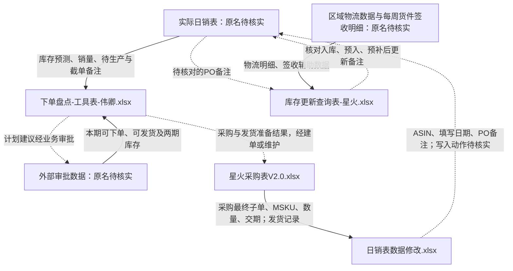

# 四张表格怎样连起来：从补货决定到采购、发货、入库，再回到盘点

> **阅读结论**：这四张表构成一个业务循环：**决定补多少 → 形成真实采购单与子单 → 整理待生产/截单备注 → 查物流并更新入库状态 → 核对库存与下一轮补货**。其中既有公式抓数，也有人或脚本搬运，不能理解为四张Excel直接全自动互相写入。
>
> 本文为2026-11-16静态核查整理稿，状态unreviewed（待业务确认）。使用表格原名，不以“采购引擎”“库存中台”等别名替换。公式取自导出文件，不代表已验证在线刷新；原表未改；2026-11-16已补齐两份新字典，并更新既有字典的跨表来源。

## 1．先对齐范围：是四张业务表，不是五张

今天分析了三张表，现有两份字典中有一份对应今天已分析的《库存更新查询表-星火.xlsx》，所以去重后共四张业务表。

| 表格原名                 | 它解决的问题                       | 在流程中的位置             | 现有字典           |
| -------------------- | ---------------------------- | ------------------- | -------------- |
| **下单盘点-工具表-伟卿.xlsx** | 该补多少、该发多少？库存和动作是否对得上？        | 循环起点的计划与核对，也接收下一轮反馈 | 下单盘点工具表字段字典    |
| **星火采购表V2.0.xlsx**   | 采购单包含哪些产品/批次？子单号、数量和发货安排是什么？ | 真实订单明细与发货记录         | 已建独立字典         |
| **日销表数据修改.xlsx**     | 哪个商品、哪一天、该填哪段采购/截单备注？        | 将订单与计划整理成日销填写结果     | 已建独立字典         |
| **库存更新查询表-星火.xlsx**  | 某个PO对应的货件到哪一步？应写入库、预入还是预补？   | 物流状态核对与更新文案         | 库存更新查询表-星火字段字典 |

另有三个必要的外部环节：**实际日销表、外部审批数据、区域物流数据**。它们的完整原文件名未由现有证据确认，所以本文使用功能描述并标“原名待核实”，不把《日销表数据修改.xlsx》冒充实际日销表，也不把任何知识页标题当作源工作簿标题。

**读法**：先读第2～3节掌握顺序；需要追某个数字时看第4～5节；维护或交接看第6～8节。

## 2．一张流程图：实线为已核查公式，虚线为业务衔接

**不要把图读成“前一张表把所有数据交给后一张”。**《星火采购表V2.0.xlsx》分别向《日销表数据修改.xlsx》提供采购明细和发货记录；《库存更新查询表-星火.xlsx》直接查区域物流数据，并非用《日销表数据修改.xlsx》作为物流底表。用户确认的“PO内容来源”与公式实际读取的“物流来源”是两层关系。

## 3．按业务发生顺序，走完这一圈

### 第一步：在《下单盘点-工具表-伟卿.xlsx》决定补多少、发多少

先接收实际日销表中的销量、预测库存和备注，结合交期、运输时间、安全库存天数形成下单/发货建议。之后，“下单汇总”“发货汇总”各自读取外部审批数据中本期允许下单、允许发货的数量。

- “下单汇总”将审批数量按单箱数量向上取整，补齐MSKU、产品SKU、供应商、店铺、条码与日期。
- 此时生成的库存备注含 **“PO待产生”**，不是实际采购单号。
- “发货汇总”独立读取审批可发货量，再到实际日销表寻找待生产、截单备注中的既有PO与数量。
- “下单汇总”传给“发货汇总”的是地址清单，不是采购数量；二者不是顺序扣减关系。

**本步交出去的是采购/发货准备信息。** 从准备信息到采购系统建单、再录入《星火采购表V2.0.xlsx》，属于业务衔接；现有文件没有证明一条公式自动完成整个建单动作。

### 第二步：在《星火采购表V2.0.xlsx》把采购单明细变成可引用的子单

“产品信息表”L:AF中已经存在逐行产品明细：L采购单号、Q品名、R产品SKU、W销售MSKU、Z采购量、AE预计到货时间。

处理顺序是：

1. **补齐归属**：Q有品名时，C取本行L；本行L为空则承接上方最近的非空采购单号。D/E/F类似补齐供应商、采购员、创建时间。
2. **自动编号**：同一C列采购单只出现一次，B保留原号；出现多次，B按该PO明细从上到下的出现次数加`-1、-2……`。
3. **过滤无效单**：I为“作废”或“转事业部”时A不输出编号，否则A取B。
4. **确定数量**：I为“作废”时G空白；其他情况J有拆单后数量就取J，否则取Z原采购量。

**子单号对应的是明细行，不是去重后的SKU。**同一SKU分四个交期占四行，就有四个子单；不同SKU也各占明细行。原始明细的批次数量先已存在，编号公式没有替业务决定分几批、每批多少。

“星火发货统计汇总”再使用最终PO子单号匹配采购信息，结合发货条码FNSKU匹配店铺、销售MSKU和ASIN，形成截单/发货记录。其“发货数量”包含计划安排，不能仅凭子表名称断言已经离厂或实际入仓。

### 第三步：《日销表数据修改.xlsx》把订单转换成可填写的备注

《日销表数据修改.xlsx》有两条并行分支，都从《星火采购表V2.0.xlsx》对应的在线数据结构取数。

| 分支 | 来源 | 识别商品 | 日期规则 | 输出备注 |
|---|---|---|---|---|
| “下单-星火”→“下单2.0” | “产品信息表”的最终子单、MSKU、数量、交期等 | MSKU查本文件“产品信息表”得到ASIN | 交期＋按国家匹配的运输天数，再处理同ASIN同日期重复行 | 预入数量，真实PO子单号，交期，待生产 |
| “截单-星火”→“截单2.0” | “星火发货统计汇总” | 发货记录直接带入ASIN | 截单日期＋按国家与发货方式匹配的运输天数，再处理重复行 | 预入数量，真实PO子单号，截单日期；AWD方式额外标注AWD |

最终统一为三个填写字段：**B列ASIN、C列填写日期、D列PO备注**。

同ASIN、同基础预计日期出现多条时，C列依次增加0、1、2……天。这是表格的填写日期规则，不是PO重新拆分，也不能当作实际运输延期。

**本步输出的是写入内容，不等于已经写入实际日销表。**外部脚本或人工搬运的执行位置、ASIN如何对应实际SKU子表，仍需验证。

### 第四步：实际日销表承接备注，成为后续查询与盘点的连接点

实际日销表不在今天三张源文件中；它通过《下单盘点-工具表-伟卿.xlsx》“日销表网址”台账定位。

业务上，实际日销表保存的是商品在不同日期的库存、销量和订单状态备注：待生产、截单、预入、入库或预补。它连接两端：

- 上游：《日销表数据修改.xlsx》提供新下单和截单的填写内容。
- 状态更新：《库存更新查询表-星火.xlsx》辅助确认既有PO的到货情况。
- 下游：《下单盘点-工具表-伟卿.xlsx》读取预测库存和备注，核对差异、计算下一轮补货。

**实际日销表是流程中的必要环节，不要把《日销表数据修改.xlsx》当成存放全部日销、库存预测的那张源表。**

### 第五步：《库存更新查询表-星火.xlsx》根据物流更新判断状态

人员查询页接收待查备注后：

1. 整理非空输入，提取PO。
2. 合并“物流数据-美／欧／亚／大洋／海外仓”，先精确匹配采购单号；无结果才包含匹配。
3. 返回PO、货件、国家、店铺、SKU、数量、仓库、预计入仓和到货日期。
4. 按返回的到货日期与今天比较，生成以前入库、今天入库、剩余预入文字；首条货件含STAR时部分合计改为预补。
5. 核对后由业务流程更新实际日销表。现有公式未证明自动写回。

这里有一条**尚未闭合的签收链**：“FBA库存数据(每周更新)”整理签收数量，物流表P/Q进一步计算“本周数据／当前入库数量”，但人员查询页只返回F:N，仍使用原N列到货日期。是否由人工把辅助结果确认后写回N列，不能从文件直接断言。

### 第六步：回到《下单盘点-工具表-伟卿.xlsx》，核对并进入下一周

“审批表核对数据”读取外部审批的两期库存、待生产、在途、可下单和可发货，核对库存与业务动作是否一致；部分AWD核对额外读取实际日销表中的“预补”备注。

“下单发货”再用更新后的预测库存、销量与订单备注计算补货建议。下单侧和发货侧不是同一口径：前者看相应到货周的预测库存及后续预入，后者还要扣除其定义下未入库的订单数量，不能把两边都概括为“库存加在途”。

**上一轮的真实订单与入库更新，成为下一轮的计划输入。**这才是四张表的完整关联。

## 4．用一个真实商品把已验证的连接走通

### 商品：加拿大原色L号刀叉盒

| 标识 | 实际值 | 用途 |
|---|---|---|
| 产品SKU | KTHDCH006-NA-L-ML2 | 采购产品识别 |
| 销售MSKU | CABJT.KTHDCH006-NA-L-ML2 | 加拿大对应销售商品 |
| ASIN | B0DZX9FXGL | 《日销表数据修改.xlsx》的填写标识 |

**采购明细 → 子单。**《星火采购表V2.0.xlsx》“产品信息表”8047:8049原始PO为PO261112357，三条明细分别是L号1000、XL号105、XXL号154。C列补齐PO后，B/A生成PO261112357-1、-2、-3。L号对应第8047行：最终子单PO261112357-1，数量1000，交期2027-01-04。

**子单 → 待生产备注。**《日销表数据修改.xlsx》“下单-星火”第465行保存了同一子单、MSKU和数量。加拿大运输参数取55天：2027-01-04＋55天＝2027-02-28。最终“下单2.0”第465行输出：

| 填写-ASIN | 填写-日期 | 填写-PO内容 |
|---|---|---|
| B0DZX9FXGL | 2027-02-28 | 预入1000，PO261112357-1，交期01.04，待生产 |

**同一商品的另一批发货计划。**《星火采购表V2.0.xlsx》“产品信息表”第7092行是PO261015069-1、504；《日销表数据修改.xlsx》“截单-星火”第8行、“截单2.0”第7行对应504，截单日期2026-11-30，方式“一拆五/普通”。加55天得到2027-01-24，生成：`预入504，PO261015069-1，11.30截单`。

**1000与504不是同一PO，不可相减得出剩余496。**它们只是同一商品的两笔不同订单。

### 这个例子追到哪里为止

本次检查《库存更新查询表-星火.xlsx》的美、欧、亚三张可见物流表，没有找到上述两个PO，不能编造该商品已入库的后续结果；也未声称它已出现在《下单盘点-工具表-伟卿.xlsx》的历史版本中。

为说明《库存更新查询表-星火.xlsx》的实际拆状态逻辑，另取其“查询(柳思）”现有 **PO260617104-3**：数量60、36、36、40、28合计200；有过去到货日期的数量164，剩余预入36。输出入库164和预入36。**这是独立示例，不与上述刀叉盒拼成同一条订单链。**

## 5．跨表交接时，究竟传什么、按什么匹配

| 从哪里 | 到哪里 | 传递内容／匹配方式 | 证据与边界 |
|---|---|---|---|
| 外部审批数据 | 《下单盘点-工具表-伟卿.xlsx》 | 按台账网址、子表名、指定日期抓可下单/可发货及库存字段 | 已核查公式；审批本身不是这个工作簿自动完成 |
| 《下单盘点-工具表-伟卿.xlsx》 | 采购建单，再到《星火采购表V2.0.xlsx》 | 产品、整箱采购量、工厂、日期等准备信息 | 业务交接；未发现自动建单公式 |
| 《星火采购表V2.0.xlsx》“产品信息表” | 《日销表数据修改.xlsx》“下单-星火”H:M | 依次取A最终子单、W MSKU、G数量、AE交期、R SKU、T分类 | 已核查导入字段与实际记录一致 |
| 《星火采购表V2.0.xlsx》“星火发货统计汇总” | 《日销表数据修改.xlsx》“截单-星火”F:M | 依次取D子单、C截单日、N MSKU、F方式、I品名、J数量、M店铺、S ASIN | 已核查导入字段与实际记录一致 |
| 《日销表数据修改.xlsx》B:D | 实际日销表 | ASIN、填写日期、备注 | 文件给出内容；脚本定位/人工写入机制未验证 |
| 实际日销表或业务待查备注 | 《库存更新查询表-星火.xlsx》人员查询页A列 | 文本提取采购单号 | 业务输入；没有证据证明自动读取该备注清单 |
| 区域物流数据 | 《库存更新查询表-星火.xlsx》 | 以PO查物流明细；以货件号查签收辅助数据 | 已核查公式；海外仓列位与其他区域不一致 |
| 《库存更新查询表-星火.xlsx》 | 实际日销表 | 人工核实的入库、预入、预补文字 | 写回动作未验证，历史入库需防重复登记 |
| 实际日销表 | 《下单盘点-工具表-伟卿.xlsx》 | 用“日销表网址”的SKU查地址，再读对应SKU子表的预测值与备注 | 已核查公式；ASIN到这里SKU子表名的对应桥梁仍需补证 |

### 四种编号各有职责

- **原始PO**：采购单整体归属，在《星火采购表V2.0.xlsx》“产品信息表”L/C列体现。
- **最终PO子单号**：采购明细行或批次的引用标识；订单、日销备注、物流查询用它串联。它不代表货件号。
- **SKU／MSKU／ASIN**：产品、销售商品及填写定位标识。不同文件里的“SKU”未必同一层，必须按对应表关联，不能直接删前缀强行对齐。
- **FNSKU／FBA货件号**：FNSKU为标签对应商品的条码；FBA货件号为物流货件标识。一个PO可以对应多个货件，不同货件的到货状态可能不同。

## 6．先守住这些口径，跨表数字才对得上

| 看起来相似的东西 | 实际区别 | 对使用者的影响 |
|---|---|---|
| “PO待产生”与真实PO子单 | 前者为计划占位，后者是《星火采购表V2.0.xlsx》输出的明细编号 | 不要拿占位文字查物流 |
| 同SKU多笔数量 | 可能不同PO、不同交期、不同状态 | 先按子单追踪，再汇总；不能任意相减 |
| 审批可发货量与待生产备注数量 | 本期允许发多少，与某一笔订单写了多少不同 | 《下单盘点-工具表-伟卿.xlsx》没有自动证明二者相等 |
| 交期、截单日、预计入仓日、实际到货日、填写日期 | 分属生产、计划、运输、状态确认、表内排布 | 同ASIN记录错开一天不代表物流延期 |
| 《日销表数据修改.xlsx》的“预入” | 下单分支附“待生产”，截单分支附截单信息 | 前缀同为预入，不等于相同库存状态 |
| 《库存更新查询表-星火.xlsx》的“入库” | 按日期对物流数量归类 | 不是当前可售库存，也未逐笔验证实际部分签收 |

### 最容易断的连接

1. **子单重编号**：《星火采购表V2.0.xlsx》按同PO行序编号。调整原始明细顺序、插行后重算可能改后缀；作废行先参与计数再被A屏蔽，不应为“补齐跳号”随意重排。
2. **备注格式改变**：《下单盘点-工具表-伟卿.xlsx》按“待生产”“截单”结尾筛选，用中文逗号提取PO。另有英文逗号的辅助文字，不能不分列直接拿去替代正式B:D输出。
3. **多批次只取一笔**：《下单盘点-工具表-伟卿.xlsx》“发货汇总”M取第一条待生产备注，V取日期最新的截单备注，均不是全部批次合计。
4. **签收没有直达前台**：《库存更新查询表-星火.xlsx》物流P/Q没有接入人员页日期判定；第一组汇总仅5行，海外仓字段还错位。
5. **写入定位缺一层证据**：《日销表数据修改.xlsx》按ASIN输出，《下单盘点-工具表-伟卿.xlsx》按SKU子表读回；真正脚本如何映射，尚未核实。
6. **版本时间不同**：《下单盘点-工具表-伟卿.xlsx》来自11月6日存档，其他三份是11月16日提供；本次验证结构和例子，不跨版本强行做全量数量对账。

## 7．四份字典的查阅入口

| 字典 | 现在怎么用 | 关联重点 |
|---|---|---|
| [[wiki/HOTOR业务/入职培训/计划岗数据表合集/下单盘点工具表字段字典]] | 查询《下单盘点-工具表-伟卿.xlsx》的补货、审批读取、两期对账和汇总字段 | 明确它既是计划起点，也是日销状态更新后的读取端；PO待产生与真实子单之间须经过采购建单 |
| [[库存更新查询表-星火字段字典]] | 查询《库存更新查询表-星火.xlsx》的PO匹配、物流日期分类和更新文字 | 采购子单生成逻辑已在《星火采购表V2.0.xlsx》定位；备注生成在《日销表数据修改.xlsx》，物流仍另有来源 |

本文是跨表总览，逐字段解释见四份对应字典。新增字典与补充内容仍标为unreviewed，未把待确认业务口径标为人工已审核。

- [[星火采购表V2.0字段字典]] — 采购明细、子单编号、数量覆盖及发货字段。
- [[日销表数据修改字段字典]] — ASIN、填写日期、备注和两条合并分支。

## 8．来源、核查与尚未闭合的环节

### 使用的原文件（链接指向不改动的归档版本）

| 表格原名 | 本次使用位置 | 关键定位 |
|---|---|---|
| [[原件存档/计划岗数据表合集/下单盘点-工具表-伟卿_v1_20261106.xlsx|下单盘点-工具表-伟卿.xlsx]] | 工作区既有归档版本 | “下单汇总”A1/D2/X3/AB3/AC3；“发货汇总”A1/D2/M3/V3；既有字典中的核对说明 |
| [[原件存档/计划岗数据表合集/星火采购表V2.0_v1_20261116.xlsx|星火采购表V2.0.xlsx]] | 原件归档 | “产品信息表”A1:G1、7092、8047:8049；“星火发货统计汇总”G2等 |
| [[原件存档/计划岗数据表合集/日销表数据修改_v1_20261116.xlsx|日销表数据修改.xlsx]] | 原件归档 | “下单-星火”H2、465；“截单-星火”F2、8；两张2.0汇总；“船代”11 |
| [[原件存档/计划岗数据表合集/库存更新查询表-星火_v1_20261116.xlsx|库存更新查询表-星火.xlsx]] | 原件归档及既有字典 | 人员页F2/C3:C5；物流表P1/Q1；“查询(柳思）”第一组算例 |

输入哈希、产物哈希和验证结果记录于各轮manifest，正式内容的业务来源与单元格定位保留于此。没有联网读取未提供的源文件，没有改动业务数据，没有运行写回脚本。文中的日期均为样例数据或公式结果，不是本次新增工作安排。

### 还需要补的四个连接

- 实际日销表、审批表、物流源表的原文件名及当前在线对应关系。
- 《日销表数据修改.xlsx》B:D究竟由哪个脚本/操作写入实际日销表；ASIN到SKU子表如何映射。
- 《库存更新查询表-星火.xlsx》的P/Q辅助结果是否有人确认后回填N；部分签收如何拆到PO/SKU。
- 审批通过的计划如何进入采购建单、原始产品明细如何进入《星火采购表V2.0.xlsx》；子单号何时固定以避免重排。

**先按已证实的字段链查数，未闭合处保留人工核对。不能把未知步骤补成一条“看起来很顺”的全自动流程。**
